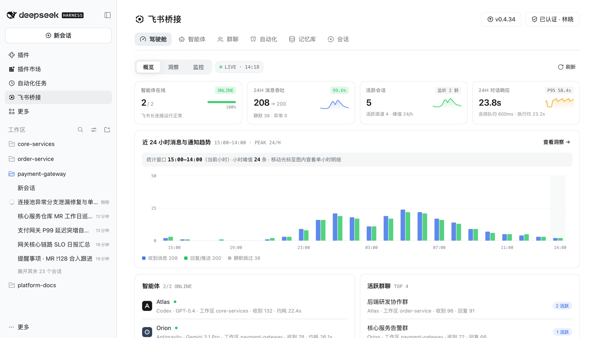
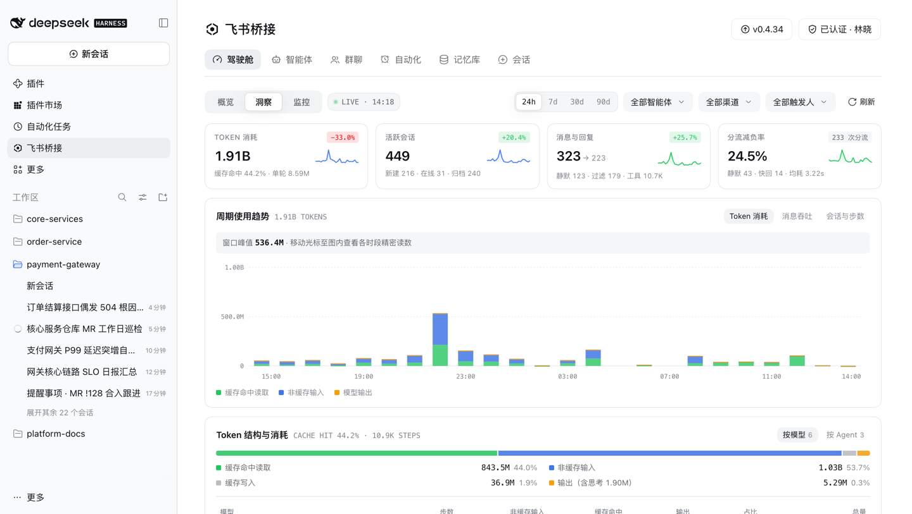
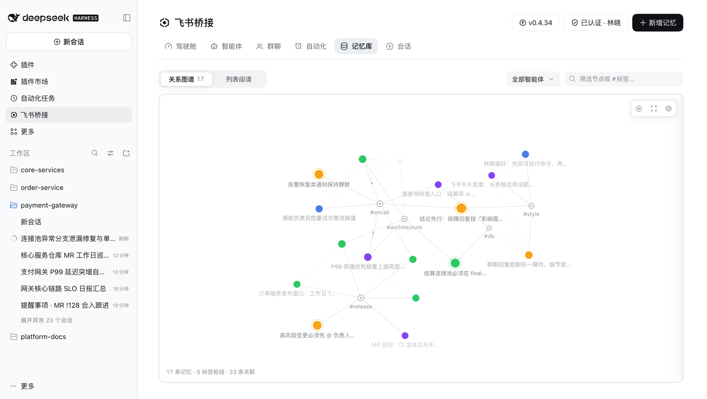
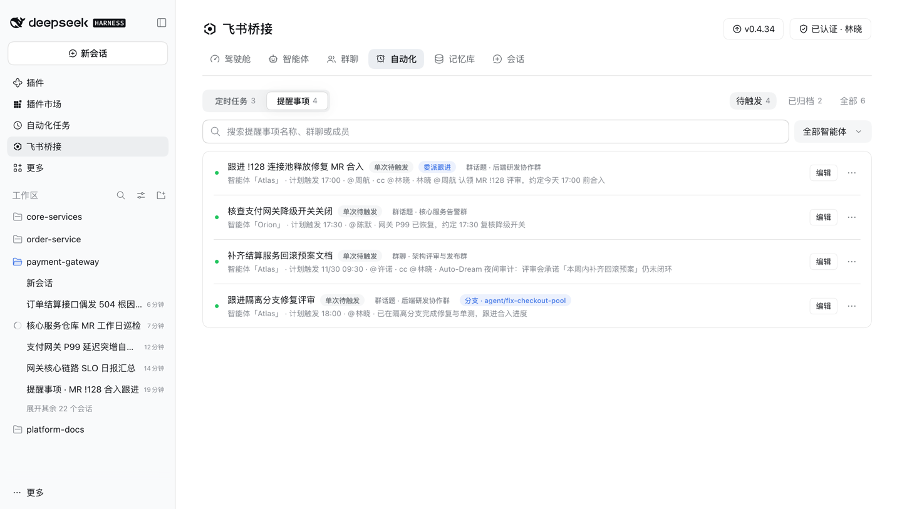
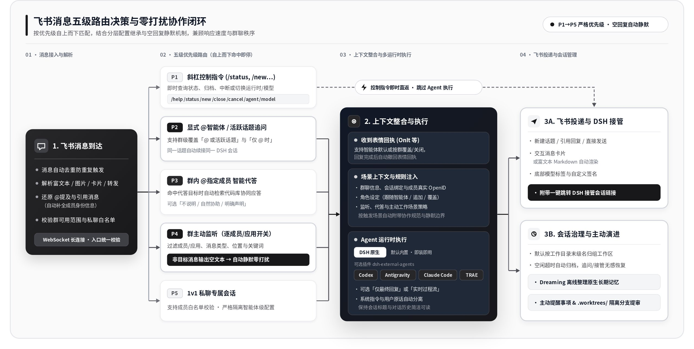

<div align="center">
  
  <h1>dsh-lark-bridge</h1>
  <p><strong>把 Claude Code / Codex / TRAE / DeepSeek Harness 变成 24 小时飞书群研发同事：<br/>零公网服务器 · 懂闭嘴不刷屏 · 晚上自己整理记忆 · 自动盯委派催办</strong></p>
  <p>
    <a href="https://github.com/harryzhz/dsh-lark-bridge/releases/latest"></a>
    <a href="./LICENSE"></a>
    <a href="https://github.com/harryzhz/dsh-lark-bridge/stargazers"></a>
    
  </p>
  <p>
    <strong>简体中文</strong> · <a href="./README_EN.md">English</a>
  </p>
  <p>
    <a href="#产品演示">产品演示</a> ·
    <a href="#一键安装3-分钟跑起来">3 分钟安装</a> ·
    <a href="#为什么不只是飞书遥控器">核心差异</a> ·
    <a href="#典型场景">典型场景</a> ·
    <a href="#核心能力详解">能力详解</a> ·
    <a href="./docs/README.md">架构文档</a>
  </p>
</div>

> 基于 [DeepSeek Harness (DSH)](https://github.com/deepseek-ai/deepseek-harness)（Desktop & Web）构建，受 [dsh-superagent](https://github.com/deepseek-ai/dsh-superagent-prototype) 与 [botmux](https://github.com/deepcoldy/botmux) 启发。默认使用 DSH 原生预设与模型；一键安装脚本已配套 [dsh-external-agents](https://github.com/harryzhz/dsh-external-agents)，开箱接入 **Claude Code、Codex、Antigravity、TRAE CLI** 等外部 Coding Agent，MIT 协议免费商用/团队自用。

---

## 为什么不只是「飞书遥控器」？

大多数飞书 Agent 桥接工具只解决「发消息转给本地 CLI」。但在真实团队研发群里，真正让你和同事天天愿意用的是**懂分寸、会记事、能主动跟进**：

| 传统飞书桥接工具 | `harryzhz/dsh-lark-bridge` |
| --- | --- |
| **只在你 `@` 它时干活，放进告警群要么叫不动、要么每条「收到」都刷屏** | **前置智能分流 + 逐成员/应用主动监听**：同事日常寒暄彻底静默；线上告警一响秒开话题查本地代码库给止损与根因，话题内追问免 `@`。 |
| **聊完即忘，昨天纠偏过的团队规范今天照样踩坑** | **跨运行时长期记忆 + Auto-Dream 夜间复盘**：群里一句「记住…」沉淀到 SQLite + FTS5 记忆库与关系图谱；每晚自动复盘增量会话、对照最新代码验真并纠偏过时规则。 |
| **群里 `A @ B` 随口约定的事很快被刷走，全靠人盯着催** | **静默委派跟进 + 核查真实状态**：自动登记群内明确指派，到期先查群历史/MR/CI 真实进展——**已闭环静默归档，未闭环才精准 `@负责人 cc 发起人`**。 |
| **只能手敲命令改代码、容易污染本地主分支，升级还得重启断任务** | **`.worktrees/` 隔离修补提审 + 驾驶舱 + 免重启热更新**：按需在隔离分支改代码跑单测提 PR；自带概览/洞察/监控三视图，支持 GitHub Release 一键原地无损热更新。 |

---

## 产品演示

https://github.com/user-attachments/assets/3f02edff-d477-49dc-a515-fc3820231f71

> **实景演示内容**：扫码一键创建飞书智能体 → 群内 `@` 查代码排障与一键回 DSH 接管 → 告警群免 `@` 主动监听 → `A @ B` 委派提醒与夜间盘点 → 长期记忆关系图谱与 Auto-Dream → 驾驶舱可观测视图。

<table>
  <tr>
    <td width="50%">
      
      <p align="center"><sub><strong>驾驶舱 · 概览</strong>：在线状态、24h 吞吐趋势、对话响应与活跃群聊</sub></p>
    </td>
    <td width="50%">
      
      <p align="center"><sub><strong>驾驶舱 · 洞察</strong>：Token 结构与缓存命中、按模型/Agent 拆解与分流漏斗</sub></p>
    </td>
  </tr>
  <tr>
    <td width="50%">
      
      <p align="center"><sub><strong>记忆库 · 关系图谱</strong>：标签枢纽与语义关联成网，支持演进生长回放</sub></p>
    </td>
    <td width="50%">
      
      <p align="center"><sub><strong>自动化 · 提醒事项</strong>：委派跟进、Auto-Dream 夜间盘点与隔离分支标签</sub></p>
    </td>
  </tr>
</table>

---

## 一键安装（3 分钟跑起来）

**不需要云服务器、不需要公网域名、不需要内网穿透**（基于飞书官方 WebSocket 长连接）。支持 macOS / Windows / Linux，一行命令自动检测本机环境并装好 **DSH + `dsh-lark-bridge` + `dsh-external-agents`**（已装兼容版本直接复用，不改已有凭据与配置）：

#### macOS / Linux

```bash
# 交互模式：自动选择 Desktop App / 独立 Web 服务 / 两版都装（Linux 自动选 Web）
curl -fsSL https://raw.githubusercontent.com/harryzhz/dsh-lark-bridge/main/scripts/install.sh | bash

# 直接指定模式（非交互可追加 -y）
curl -fsSL https://raw.githubusercontent.com/harryzhz/dsh-lark-bridge/main/scripts/install.sh | bash -s -- --mode app
curl -fsSL https://raw.githubusercontent.com/harryzhz/dsh-lark-bridge/main/scripts/install.sh | bash -s -- --mode web
```

#### Windows (PowerShell)

```powershell
# 交互模式
irm https://raw.githubusercontent.com/harryzhz/dsh-lark-bridge/main/scripts/install.ps1 | iex

# 直接指定模式（app / web / both）
$env:DSH_INSTALL_MODE = 'app'; irm https://raw.githubusercontent.com/harryzhz/dsh-lark-bridge/main/scripts/install.ps1 | iex
```

### 扫码接入只需 3 步

1. **打开控制台**：Desktop 版启用插件后点击左侧 **飞书桥接**；独立 Web 版运行 `dsh web`（或 `dsh --profile web --no-open --port 3880` 后台常驻）。
2. **扫码一键建机器人**：点右上角 **飞书认证** 扫码登录开放平台 → **智能体 → 新增智能体**，填名字、本地工作目录与运行时（DSH / Claude Code / Codex / TRAE），扫码自动创建应用、配齐权限并拉起长连接（也支持接入已有应用）。
3. **拉进群直接用**：在飞书里把智能体拉进群，自动启用并打招呼（或到 **群聊** 页点 **同步群聊** 精细配置角色与监听规则）。

<details>
<summary>展开查看：安装模式对比、一键脚本可选参数、手动安装方式（界面 / <code>dsh plugin</code> CLI）与免重启热更新</summary>

#### 前置要求与安装模式

- 前置环境：`DeepSeek Harness >= 0.2.2-rc.5`（Desktop App 内置运行时无需预装 Node；独立 Web 版需 `Node.js >= 22.13.0`）。

| 安装模式 | 适用场景 | 支持平台 | 安装内容 |
| --- | --- | --- | --- |
| **Desktop App 版**（`--mode app`） | 个人桌面日常使用，开箱即用 | macOS / Windows | 自动安装官方 Desktop 客户端并激活双插件 |
| **Web 版**（`--mode web`） | 局域网 / 服务器后台常驻、免重启热更新 | macOS / Linux / Windows | 自动准备 Node 22 + pnpm + `@deepseek-ai/dsh`（免 sudo），向 `web` profile 安装双插件并默认绑定局域网 IPv4 |
| **两版都装**（`--mode both`） | 同时使用桌面端与独立 Web 服务 | macOS / Windows | 依次完成两套环境安装与激活 |

#### 一键脚本常用可选参数

| 参数（`install.sh` / `install.ps1`） | 环境变量 | 说明 |
| --- | --- | --- |
| `--mode <auto\|web\|app\|both>` / `-Mode` | `DSH_INSTALL_MODE` | 指定安装模式（`install.sh` 亦支持 `--web` / `--app` / `--both`） |
| `--web-host <auto\|loopback\|IP>` / `-WebHost` | `DSH_WEB_HOST` | Web 版默认监听地址：默认 `auto`（自动绑定局域网 IPv4，离线回退 `127.0.0.1`） |
| `--without-external-agents` / `-WithoutExternalAgents` | `DSH_WITHOUT_EXTERNAL_AGENTS=1` | 仅安装 `dsh-lark-bridge`，不安装 `dsh-external-agents` |
| `--upgrade-dsh` / `-UpgradeDsh` | `DSH_UPGRADE=1` | 即使已存在兼容版 DSH，也升级到最新版 |
| `--force` / `-Force` | `DSH_FORCE=1` | 强制重新安装目标版本插件 |
| `--github-proxy <url>` / `-GithubProxy` | `GITHUB_PROXY` | 为 GitHub Release 下载添加镜像前缀 |
| `--dry-run` / `-DryRun` | `DSH_DRY_RUN=1` | 仅检测环境并打印安装计划，不做实际修改 |
| `-y, --yes` / `-Yes` | `DSH_YES=1` | 非交互模式，自动确认全部提示 |

#### 手动方式一：DSH 界面安装（Desktop / Web）

1. 打开侧边栏 **插件 → 添加插件**。
2. 填入 GitHub Release `.tgz` 地址（推荐，免构建脚本）并点击 **安装**：
   - 飞书桥接：`https://github.com/harryzhz/dsh-lark-bridge/releases/latest/download/dsh-lark-bridge.tgz`
   - 外部 CLI 运行时（可选）：`https://github.com/harryzhz/dsh-external-agents/releases/latest/download/dsh-external-agents.tgz`（启用后重启一次 DSH）
3. 点击 **立即启用**，热加载生效，左侧边栏立即出现 **飞书桥接**。

#### 手动方式二：`dsh plugin` CLI 安装（独立 Web 服务）

> `--profile <name>` 须写在 `add` / `remove` 之前；`desktop` profile 仅由桌面端界面或其内置 CLI 管理。

```bash
# 从 GitHub Release latest .tgz 安装（推荐，免构建脚本）
dsh plugin --profile web add \
  https://github.com/harryzhz/dsh-external-agents/releases/latest/download/dsh-external-agents.tgz \
  https://github.com/harryzhz/dsh-lark-bridge/releases/latest/download/dsh-lark-bridge.tgz

# 校验、更新与卸载
dsh --profile web --dump-config
dsh plugin --profile web update @harryzhz/dsh-lark-bridge
dsh plugin --profile web remove @harryzhz/dsh-lark-bridge
```

#### 日常升级（免重启热更新）

- 有新 Release 时，控制台右上角显示更新角标，点击即可**原地免重启热更新**（也可运行 `lark-bridge plugin update`）。
- 仅在升级 DSH 本体或调整底层配置确需重启常驻 Web 服务时，先执行 `lark-bridge lifecycle drain --wait --reason "upgrade"` 排空在途回合后再重启，避免中断群聊推理。
- 插件启动时自动装配 `~/.local/bin/lark-bridge`（Windows 为 `lark-bridge.cmd`）与 `~/.agents/skills/lark-bridge/SKILL.md`。反向代理场景可传 `--public-url https://<域名> --trusted-host <域名>`。

</details>

---

## 典型场景

| 场景 | 推荐配置 | 实际效果 |
| --- | --- | --- |
| **研发群驻群搭档** | 群绑定服务仓库；会话选「话题内回复 + 按话题复用 + `@` 或活跃话题」；开启原生思考过程气泡 | `@Bot` 查提交、定位根因、改代码跑单测并收进话题；同话题免 `@` 追问，点卡片一键回 DSH 接管。 |
| **告警群自动值班** | 「主动监听」选 **告警排查** 模板（或用 AI 一键生成自定义模板），仅开告警应用、关闭人类成员 | 同事日常沟通零打扰；P0/P1 告警卡片一到秒开话题给止损、根因与核查命令。 |
| **群内委派防遗漏** | 「实验性」开启 **主动创建提醒 + 委派事项跟进 + 夜间免打扰** | 同事间 `A @ B` 认领的任务自动静默跟进；到期先查真实进展，已闭环静默归档，未闭环精准 `@` 提醒。 |
| **团队知识越用越准** | 「实验性」开启 **Dreaming 与长期记忆**，通过 **记忆库** 置顶核心规范 | 群内一句话「记住…」即刻生效；每晚 Auto-Dream 复盘整理并纠偏过时经验，新老会话风格始终一致。 |
| **每日巡检静默播报** | 「自动化 → 定时任务」绑定目标群，推送时机选 **有内容或异常时** | 一切正常零消息打扰；发现阻塞 MR 或指标异常自动发卡片并精准 `@` 对应处理人。 |
| **负责人繁忙期代答** | 「权限与代答」添加目标负责人，身份说明选 **自然协助说明** 并开启话题续跟 | 群内 `@负责人` 问代码或接口细节时，智能体先查证作答并承接追问，高风险决策留给本人确认。 |

---

## 核心能力详解

### 1. 六大亮点一览

1. **零公网暴露，3 分钟跑起来**：官方 WebSocket 长连接 + 一键脚本 + 飞书扫码自动建应用，入群自动启用并打招呼。
2. **多引擎无侵入，一个群一套配置**：兼容 DSH 原生预设及 **Claude Code / Codex / Antigravity / TRAE**；研发群、告警群、发布群各自独立绑定代码仓库、运行时、模型、并发上限与角色设定，支持 AI 一键生成定制角色与监听规则。
3. **懂分寸、不刷屏的智能分流与主动监听**：轻量前置分流 + 逐成员/应用监听开关，日常寒暄静默、复杂排障开话题并支持**飞书原生思考过程气泡**与一键跳回 DSH 接管会话。
4. **越用越懂团队的跨运行时长期记忆 + Auto-Dream**：统一沉淀在 SQLite + FTS5 中英文混合检索引擎与只读 `MEMORY.md` 镜像，按全局/工作区/群聊三级隔离、双时态纠偏留痕；每晚低优先级自动复盘验真与清理。
5. **说到做到的主动提醒、委派跟进与隔离修补**：自动静默跟进群内 `A @ B` 指派，到期查真实状态决定归档还是提醒；按需在 `.worktrees/` 隔离分支改代码、跑单测并提审 PR/MR，绝不污染主分支。
6. **生产级可观测与免重启热更新**：驾驶舱「概览 / 洞察 / 监控」三视图观测吞吐、Token 成本与缓存命中、分流减负率、P50/P95 延迟与 SQLite WAL 健康度；内置 GitHub Release 保活热更新与 `lifecycle drain` 零中断排空。

### 2. 系统分层架构与消息路由

插件采用防腐层解耦设计，独立封装飞书接入、消息路由、记忆存储、可观测与控制台能力（兼容 Desktop 与 Web）；外部 CLI Agent 由独立插件 `dsh-external-agents` 按需提供。


每条入站消息经去重、富媒体与引用上下文解析后，按五级优先级决策，配合前置轻量分流与四套内置主动监听模板，在「该出手时秒回、不该插话时零打扰」之间取得平衡：



### 3. 控制台六大视图与分层配置

| 页签 | 核心能力 |
| --- | --- |
| **驾驶舱** | **概览**（在线状态、24h 吞吐趋势、活跃群聊）、**洞察**（Token 结构与缓存命中、按模型/Agent/群拆解、分流漏斗与 7×24h 活跃矩阵）、**监控**（SLA、回复耗时分布、长连接 ACK 延迟、进程与 SQLite WAL 健康度）。 |
| **智能体** | 扫码创建或接入已有飞书应用、启停长连接、断线重连、同步头像与简介、进入分层配置。 |
| **群聊** | 按群独立启停、绑定代码目录与工作区、覆盖运行时/模型/消息/角色设定、配置前置智能分流与主动监听规则（支持 AI 生成模板）。 |
| **自动化** | **定时任务**（将 DSH 定时任务绑定到多个飞书群，支持「有内容或异常时」静默策略）；**提醒事项**（管理待触发与已归档提醒，支持编辑唤醒指令、审批与立即核查）。 |
| **记忆库** | Obsidian 风格**关系图谱**（标签枢纽、语义关联、演进生长回放与节点精读抽屉）与**列表阅读**（分类/层级树、检索排序、双时态纠偏）。 |
| **会话** | 统一查看**对话会话 / 智能分流记录 / Dreaming 整理记录**与运行审计日志，一键跳回 DSH 打开或解绑归档。 |

<details>
<summary>展开查看：智能体与群聊分层配置矩阵、四套内置主动监听模板、飞书 <code>/slash</code> 命令与 <code>lark-bridge</code> CLI</summary>

#### 智能体与群聊分层配置

智能体配置（6 组）与群聊配置（5 组）共用前 4 组导航，群聊默认 **跟随智能体** 并可直接只读预览继承值：

| 配置组 | 智能体默认 | 群聊覆盖 |
| --- | --- | --- |
| **基本信息** | 默认工作目录（支持原位浏览/新建目录）、工作区名称 | 按群绑定独立仓库目录，同目录自动归入同一工作区 |
| **Agent 运行时** | DSH 原生预设或外部 CLI、模型与推理强度、每运行时并发上限热调、前置智能分流模型与范围 | 跟随智能体或独立覆盖 |
| **会话与消息** | 可用范围、触发方式（`@ 或活跃话题`）、按话题复用、空闲归档（默认 `720` 分钟）、处理中表情（`OnIt`）、飞书原生思考过程气泡、消息卡片与 DSH 接管链接 | 逐项覆盖；新群默认按 `360` 分钟空闲归档、话题内回复与富文本初始化 |
| **角色设定** | 4 套内置预设（研发搭档、架构评审、值班排障、技术顾问）或 AI 生成/自定义 | 跟随 / 追加 / 覆盖 |
| **权限与代答** | 管理员名单、私聊开关与白名单、群内 `@指定成员` 代答（3 种身份说明 + 话题续跟） | 仅智能体级生效 |
| **主动监听** | 默认关闭 | 逐成员/应用开关、消息类型/关键词过滤、防抖与 4 套场景模板 / AI 生成 |
| **实验性** | **Dreaming 与长期记忆**（夜间多阶段整理、独立整理模型与预算上限）+ **主动工作**（主动提醒、委派跟进、夜间免打扰、`.worktrees/` 隔离提审） | 仅智能体级生效，提醒自动继承来源群/话题路由 |

#### 四套内置主动监听模板

| 内置监听模板 | 默认监听与投递 | 触发边界 |
| --- | --- | --- |
| **告警排查** | 告警应用 + 成员 · 话题内回复 · 按话题复用 | 仅响应告警卡片、指标异常与部署失败；恢复类与日常确认静默，命中后按「止损 → 根因 → 后续行动」回复。 |
| **项目讨论** | 群成员 · 话题内回复 · 按话题复用 | 仅在查证仓库代码/文档有确切依据时插话；指派他人的事务与寒暄静默。 |
| **变更观察** | 成员 + 应用 · 引用回复 · 单次归档 | 观察合入、发布与配置变更；常规无风险变更静默，发现协议不兼容或缺回滚预案时预警。 |
| **工作日常** | 群成员 · 直发 · 单次归档 | 回答开放性流程或工具疑问，自动跳过「收到 / 好的 / +1」等短消息。 |

#### 飞书 `/slash` 命令

| 飞书斜杠命令 | 说明 |
| --- | --- |
| `/help` | 查看当前可用命令 |
| `/status` | 查看当前会话 ID、工作区、运行时与模型、工作目录及 DSH 接管链接 |
| `/new` 或 `/close` | 归档当前会话，下条消息开启新上下文 |
| `/cancel` | 中断当前正在执行的推理或工具调用 |
| `/cot [on\|off\|inherit\|status]` | 查看或开关飞书原生思考过程气泡（群聊修改需管理员权限） |
| `/console` | 仅管理员可用：生成一次性免密链接快速登录 DSH Web 控制台 |
| `/agent <id>` / `/model <id>` | 切换当前群或会话的运行时 / 模型 |

#### 常用 `lark-bridge` CLI 命令（自动装配，不向会话暴露应用密钥）

```bash
# 1. 上下文、智能体、群聊与本群应用级真实成员 OpenID
lark-bridge context
lark-bridge bots
lark-bridge chats
lark-bridge members --query "姓名"

# 2. 发送图文混排卡片或本地附件（支持 <at id="ou_xxx">姓名</at>）
lark-bridge send --image ./latency-trend.png <<'EOF'
## 核心接口延迟恢复确认


限流降级生效后，P99 已回落至 45ms 以内。
EOF
lark-bridge send --file ./audit-report.pdf "巡检报告见附件。"

# 3. 读取群/话题历史与被引用消息（自动下载图片与文件附件）
lark-bridge history --limit 30
lark-bridge message om_example_quoted_id

# 4. 长期记忆检索、沉淀与双时态纠偏
lark-bridge memory search "发布窗口"
lark-bridge memory upsert --type feedback --title "排障结论先行" --content "按影响面 → 止损 → 根因输出。" --pin
lark-bridge memory supersede <oldId> --reason "已改用异步补偿" --type project --title "新策略" --content "详见最新复盘。"

# 5. 一次性跟进提醒、静默控制与隔离 Git Worktree
lark-bridge reminder list --status active
lark-bridge reminder create --kind delegation --title "跟进 !128 MR 合入" --at "2026-11-27 17:00" \
  --mention "<owner_open_id>:负责人" --cc "<initiator_open_id>:发起人" \
  --prompt "核查 MR 与 CI 状态：已合入则运行 lark-bridge silence 静默归档，否则同步阻塞点。"
lark-bridge silence --reason "已闭环，无需提醒"
lark-bridge worktree create fix-checkout-pool --prefix agent/

# 6. 定时巡检任务与宿主机运维（健康检查 / 免重启热更新 / 优雅排空重启）
lark-bridge schedule create --title "工作日服务巡检" --weekly "1,2,3,4,5@09:30" --tz Asia/Shanghai --prompt-file ./patrol.md
lark-bridge doctor
lark-bridge plugin status --check
lark-bridge plugin update
lark-bridge lifecycle status
lark-bridge lifecycle drain --wait --reason "upgrade"
```

</details>

---

## 常见问题

| 现象 | 原因 | 处理方式 |
| --- | --- | --- |
| `<at id="ou_xxx">` 未高亮提及成员 | 飞书 `open_id` 按应用隔离，不同智能体的 ID 不通用 | 始终通过 `lark-bridge members` 查询当前智能体在本群的真实成员 ID |
| 群聊列表看不到新拉入的群 | 尚未产生消息或未刷新目录 | 在 **群聊** 页或智能体菜单点击 **同步群聊** |
| 找不到新建定时任务或改 Cron 的入口 | 「自动化 → 定时任务」管理飞书群通知绑定 | 点击顶部 **自动化任务 ›** 进 DSH 原生面板，或运行 `lark-bridge schedule create` |
| 想实时看或关闭 Agent 思考与查代码过程 | 新建智能体默认开启原生思考气泡，也可按群覆盖 | 在智能体「会话与消息」开关 **展示思考过程**，或群内发 `/cot on\|off\|inherit` 随时切换 |
| 想在线升级插件但不打断正在跑的任务 | Web 版支持免重启热更新 | 点控制台右上角版本徽标或执行 `lark-bridge plugin update` 原地热更新 |
| 群里机器人没反应或离线 | 休眠/切网导致长连接重连 | 默认数秒内自动重连，也可在智能体菜单点 **重新连接** 或运行 `lark-bridge doctor` 诊断 |

---

## 文档导航与开发打包

- **文档索引**：[docs/README.md](./docs/README.md)（系统架构 [overview.md](./docs/architecture/overview.md) · 消息路由与会话 [session-management.md](./docs/architecture/session-management.md) · 长期记忆与 Auto-Dream [memory-and-dreaming.md](./docs/architecture/memory-and-dreaming.md) · 开发规范 [development.md](./docs/guidelines/development.md) · UI 规范 [ui.md](./docs/guidelines/ui.md) · 安全策略 [SECURITY.md](./SECURITY.md)）

```bash
pnpm install
pnpm build && pnpm typecheck && pnpm test && pnpm run check:privacy

# 打包 .tgz（输出到 .local/releases/）
pnpm run pack:bundle
```

## License

[MIT](./LICENSE)
