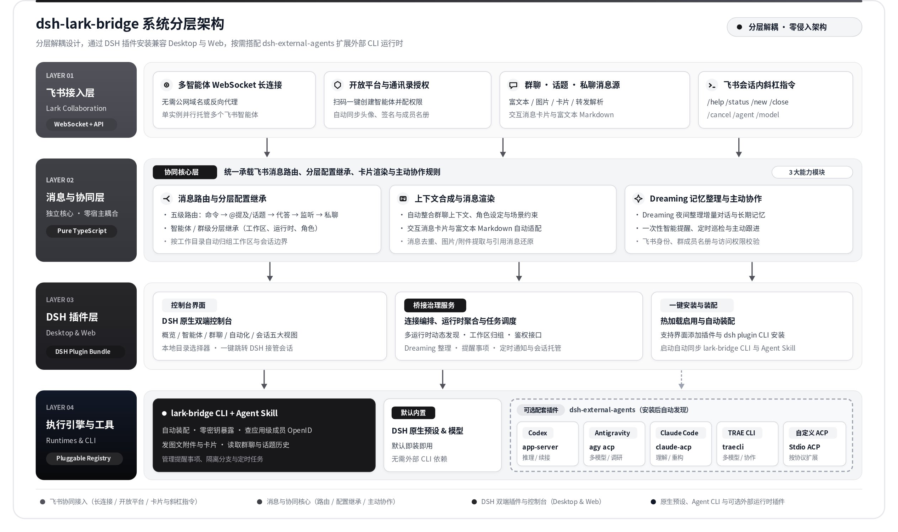

# dsh-lark-bridge

> 本项目受 [dsh-superagent](https://github.com/deepseek-ai/dsh-superagent-prototype) 和 [botmux](https://github.com/deepcoldy/botmux) 启发。

面向 [DeepSeek Harness (DSH)](https://github.com/deepseek-ai/deepseek-harness) Desktop 与 Web 的飞书（Lark）智能体桥接、让 Agent 参与到飞书协作与主动协作的插件：通过飞书官方 WebSocket 长连接把私聊、群聊、话题和本地代码工作区打通，无需公网域名或反向代理。

默认直接使用 DSH 原生预设与模型，不改动用户默认配置；如需接入 Codex、Antigravity、Claude Code 或 TRAE CLI，按需安装配套插件 [dsh-external-agents](https://github.com/harryzhz/dsh-external-agents) 即可自动发现。

## 产品演示

https://github.com/user-attachments/assets/3f02edff-d477-49dc-a515-fc3820231f71

> 完整演示视频（1080p，约 95 秒）：涵盖扫码创建飞书智能体、群内 `@` 协作与一键跳转 DSH 接管会话、告警群免 `@` 主动监听、定时任务与一次性提醒事项。

## 1. 核心能力

- **多引擎无侵入桥接**：单实例并行托管多个飞书自建应用，默认使用 DSH 原生预设与模型；搭配 `dsh-external-agents` 后自动发现 Codex、Antigravity、Claude Code、TRAE 及自定义 ACP 运行时。
- **群级精细监听与治理**：智能体与群聊共享分层继承配置，可按群独立绑定代码仓库、运行时、模型、角色设定与消息策略；支持逐成员/应用监听开关与四套场景模板，无需插话时输出空文本即静默跳过。
- **离线记忆与主动协作**：内置夜间 **Dreaming** 离线记忆整理、一次性智能跟进提醒（到期核查，已闭环静默归档），以及在 `.worktrees/` 隔离分支改代码提审。
- **会话互通与工具链**：飞书卡片支持一键跳转 DSH 接管会话；启动时自动装配 `lark-bridge` CLI 与配套技能，不向会话暴露应用密钥。

## 2. 安装与使用

前置环境：支持 macOS / Windows / Linux，需 `Node.js >= 22.0.0`、`DeepSeek Harness >= 0.2.2-rc.5`。

### 2.1 安装插件

#### 方式一：DSH 界面安装（Desktop / Web，推荐）

1. 打开侧边栏 **插件 → 添加插件**。
2. 填入任一安装源并点击 **安装**：
   - **GitHub Release `.tgz`（推荐，免构建脚本）**：
     - 飞书桥接：`https://github.com/harryzhz/dsh-lark-bridge/releases/latest/download/dsh-lark-bridge.tgz`
     - 外部 CLI 运行时（可选，支持 Codex / Antigravity / Claude Code / TRAE）：`https://github.com/harryzhz/dsh-external-agents/releases/latest/download/dsh-external-agents.tgz`（启用后重启一次 DSH）
   - **GitHub 仓库**：`github:harryzhz/dsh-lark-bridge`（或 `https://github.com/harryzhz/dsh-lark-bridge`；pnpm ≥ 10 首次会拦截 `prepare` 脚本，按界面提示点击 **允许这些脚本并重试**）
     - 外部 CLI 运行时（可选）：`github:harryzhz/dsh-external-agents`（或 `https://github.com/harryzhz/dsh-external-agents`）
   - **本地源码目录**：先在仓库运行 `pnpm install && pnpm build`，再填入绝对路径
3. 点击 **立即启用**：支持热加载生效，无需重启，左侧导航栏随即出现 **飞书桥接**。

#### 方式二：`dsh plugin` CLI 安装（独立 Web 服务 / 服务器常驻）

> `--profile <name>` 须写在 `add` / `remove` 之前。`desktop` profile 由桌面端托管，请使用上方界面安装。

```bash
# 从 GitHub Release latest .tgz 安装（推荐，免构建脚本）
dsh plugin --profile web add https://github.com/harryzhz/dsh-lark-bridge/releases/latest/download/dsh-lark-bridge.tgz

# 可选：一并安装外部 CLI Agent 插件（Codex / Antigravity / Claude Code / TRAE）
dsh plugin --profile web add \
  https://github.com/harryzhz/dsh-external-agents/releases/latest/download/dsh-external-agents.tgz \
  https://github.com/harryzhz/dsh-lark-bridge/releases/latest/download/dsh-lark-bridge.tgz

# 从 GitHub 仓库安装（也可使用 https://github.com/harryzhz/dsh-lark-bridge）
dsh plugin --profile web add github:harryzhz/dsh-lark-bridge

# 从本地已构建仓库安装
dsh plugin --profile web add file:/absolute/path/to/dsh-lark-bridge

# 校验、更新与卸载
dsh --profile web --dump-config
dsh plugin --profile web update @harryzhz/dsh-lark-bridge
dsh plugin --profile web remove @harryzhz/dsh-lark-bridge
```

从 Git 仓库安装时，若 pnpm ≥ 10 拦截了 `prepare` 脚本，将以下内容写入 `$DSH_HOME/profiles/web/pnpm-workspace.yaml` 后重试 `add`：

```yaml
allowBuilds:
  '@harryzhz/dsh-lark-bridge': true
  '@harryzhz/dsh-external-agents': true # 若同时安装了外部运行时插件
```

如额外安装了 `dsh-external-agents`，重启一次 DSH 即可自动发现全部外部运行时。

### 2.2 启动与自动装配

- **DSH Desktop**：在「插件」页启用后，直接点击左侧 **飞书桥接** 进入控制台。
- **独立 DSH Web 服务**：安装插件后直接用标准 `dsh` 命令启动，需要后台保活时用 macOS LaunchAgent 或 systemd 托管即可（确保 `PATH` 包含 `~/.local/bin` 及所用外部 CLI 路径）。

```bash
# 本机使用
dsh web

# 局域网 / 服务器常驻（指定本机具体 IPv4 与端口）
dsh --profile web --no-open --host <本机IPv4> --port 3880

# 验证插件自动装配的 CLI 连通性
lark-bridge context
```

反向代理场景可通过 `--public-url https://<域名> --trusted-host <域名>` 指定外部访问入口，或在 `$DSH_HOME/profiles/web/cordis.patch.yml` 中为 `id: dsh-lark-bridge` 配置 `publicBaseUrl`：

```yaml
- id: dsh-lark-bridge
  config:
    publicBaseUrl: https://dsh.example.com
```

插件启动时会自动安装并维护 `~/.local/bin/lark-bridge`（Windows 为 `lark-bridge.cmd`）、`~/.agents/skills/lark-bridge/SKILL.md` 及 `~/.dsh/lark-bridge/cli-endpoint.json`。

#### 优雅重启（零中断排空，默认超时 2 分钟）

升级插件或重启常驻 DSH 服务前，建议先在**宿主机运维终端**（非 Agent 会话）执行排空，避免直接中断正在推理或回复中的飞书会话。`lark-bridge lifecycle drain --wait` 会立即暂停所有智能体的飞书入站长连接与新定时/提醒派发，同时保持出站 REST 在线，等待在途回合自然回复完成后再退出（**默认等待超时 2 分钟 / `120` 秒**，可用 `--timeout <秒>` 覆盖，上限 `900` 秒）：

```bash
# 1. 可选：查看当前活跃会话与在途任务数
lark-bridge lifecycle status

# 2. 排空并等待在途任务完成（默认超时 2 分钟 / 120 秒）
#    - 仅在完全排空时重启（严格零中断；若超时退出码为 2，则中止重启）
lark-bridge lifecycle drain --wait --reason "upgrade" \
  && launchctl kickstart -k "gui/$(id -u)/com.example.dsh-web"   # macOS LaunchAgent 示例
# Linux systemd 示例：&& systemctl --user restart dsh-web
# 手动进程示例：      && kill -TERM <dsh_pid>

#    - 限时等待最多 2 分钟后必然重启（超时退出码为 2 时仍重启，未完成回合由断点自动续跑）
lark-bridge lifecycle drain --wait --reason "upgrade"
rc=$?
if [ "$rc" -eq 0 ] || [ "$rc" -eq 2 ]; then
  launchctl kickstart -k "gui/$(id -u)/com.example.dsh-web"
fi

# 3. 若决定取消本次重启，恢复飞书入站接单
lark-bridge lifecycle resume-intake
```

- **权限边界**：`drain` 与 `resume-intake` 需宿主机本机运维凭证（`$DSH_HOME/lark-bridge/operator-token`，权限 `0600`）或控制台 Owner 会话，在 Agent 会话内默认拒绝执行。
- **退出码与兜底恢复**：`0` 表示全部在途任务已排空；`2` 表示超过等待超时（默认 `120` 秒）仍有在途任务；`1` 表示命令或鉴权错误。即便在退出码 `2` 时继续重启或发生非计划重启，在途回合也会持久化断点至 SQLite `pending_turns`（保留原 `OnIt` 表情），新进程启动后自动补发已完成回复或续跑未完成回合（15 分钟窗口内最多自动恢复 1 次）；新实例启动还会自动等待旧进程最多 `6` 秒平滑交接 `bridge.lock`。

### 2.3 扫码创建飞书智能体

控制台支持 **自动创建飞书智能体**（开放平台全自动创建 / 扫码快速注册 SDK）与 **接入已有应用** 两种方式：

1. 点击右上角 **飞书认证**，使用飞书移动端扫码登录开放平台。
2. 切至 **智能体 → 新增智能体**，填写名称、简介、默认工作目录（支持右侧图标直接浏览或新建宿主机目录）与默认运行时，提交并扫码确认；系统会自动创建企业自建应用、配齐权限、建立 WebSocket 长连接并同步头像与简介。
3. **通讯录搜索授权（可选）**：在「飞书认证」弹窗中为对应智能体完成一次用户授权，即可在配置私聊白名单和代答成员时按姓名/邮箱搜索全企业成员。
4. 在飞书把智能体拉入协作群，回到 **群聊** 页点击 **同步群聊** 即可纳管。

## 3. 系统分层架构

插件采用分层解耦设计，独立封装飞书接入、消息路由与控制台能力（兼容 Desktop 与 Web），启动时自动装配 `lark-bridge` CLI 与配套技能；外部 CLI Agent 由独立插件 `dsh-external-agents` 按需提供。



## 4. 核心功能

### 4.1 控制台视图

| 页签 | 用途 |
| --- | --- |
| **概览** | 在线智能体数、活跃会话、近 24 小时逐小时消息/推送趋势、响应耗时与最近动态。 |
| **智能体** | 创建或接入智能体、启停长连接、断线重连、同步头像与简介、进入分层配置。 |
| **群聊** | 按群开关响应、绑定独立代码目录与工作区、覆盖运行时/消息/角色设定及主动监听规则。 |
| **自动化** | 「定时任务」管理飞书多群通知（可直达 DSH 原生自动化任务面板）；「提醒事项」管理一次性跟进提醒。 |
| **会话** | 查看群/话题与 DSH 会话的映射关系，一键在 DSH 打开或手动归档解绑。 |

### 4.2 分层配置与继承

智能体配置（6 组）与群聊配置（5 组）共用前 4 组导航，群聊默认 **跟随智能体** 并可直接只读预览继承值：

| 配置组 | 智能体默认 | 群聊覆盖 |
| --- | --- | --- |
| **基本信息** | 默认工作目录（支持浏览或新建目录）；工作区留空取目录末级名 | 按群绑定独立仓库目录，同一目录自动归入同一工作区 |
| **Agent 运行时** | DSH 原生预设，或由 `dsh-external-agents` 提供的外部 CLI；模型与推理强度联动 | 跟随智能体或独立指定 |
| **会话与消息** | 触发方式（`@ 或活跃话题`）、按话题复用、空闲归档（默认 `720` 分钟）、话题内回复、处理中表情（`OnIt`）、仅最终回复、消息卡片与 DSH 接管链接 | 逐项覆盖；关闭卡片时自动转为富文本 Markdown 发送 |
| **角色设定** | 4 套内置预设（研发搭档、架构评审、值班排障、技术顾问）或自定义 | 跟随 / 追加 / 覆盖 |
| **私聊与代答** | 私聊开关与成员白名单；群内 `@指定成员` 代答（3 种身份说明 + 话题续跟） | 仅智能体级生效 |
| **主动监听** | 默认关闭 | 逐成员/应用开关、消息类型/关键词过滤与 4 套场景模板 |
| **实验性** | **Dreaming** 离线记忆整理 + **主动工作**（一次性提醒、隔离分支提审） | 仅智能体级生效，提醒自动继承来源路由 |

### 4.3 五级路由与零打扰主动监听

每条进入长连接的飞书消息在自动去重并解析富媒体（`@提及`、图片、卡片与合并转发）后，按五级优先级完成路由，并结合所属群的角色设定、成员信息与触发场景交给 Agent 处理：


**内置四套主动监听模板**（在群聊配置中修改判断指令并保存时，会同步更新所选模板）：

| 模板 | 默认监听与投递 | 触发边界 |
| --- | --- | --- |
| **告警排查** | 告警应用 + 成员 · 话题内回复 · 按话题复用 | 仅响应告警卡片、指标异常与部署失败；恢复通知和日常确认静默，命中后按「止损 → 根因 → 后续行动」回复。 |
| **项目讨论** | 群成员 · 话题内回复 · 按话题复用 | 仅在核实仓库代码/文档有确切依据时插话；指派他人的事务与寒暄静默。 |
| **变更观察** | 成员 + 应用 · 引用回复 · 单次归档 | 观察合入、发布与配置变更；常规无风险变更静默，发现兼容性或回滚风险时预警。 |
| **工作日常** | 群成员 · 直发 · 单次归档 | 回答开放性流程或工具疑问，自动跳过「收到 / 好的 / +1」等短消息。 |

> 点击卡片底部 **在 DSH 接管会话**时，桌面端会优先直接唤起 DSH Desktop 并定位到对应会话，未打开桌面窗口时自动平滑回退到浏览器；即使会话已因超时归档，也会自动取消归档并还原原上下文。

### 4.4 实验性能力：Dreaming 与主动工作

在 **智能体 → 配置 → 实验性** 按智能体独立开关：

- **Dreaming 离线记忆整理**：每日定时（默认 `02:00`）且新增会话达到阈值（默认 `2`）时，自动汇总近期增量会话摘要与代码库变更，唤醒智能体调用自身长期记忆机制提炼关键经验、合并重复项并清理过期内容。提炼范围支持单层标签流自由增删改，并可随时点击 **立即整理** 手动触发。
- **主动创建提醒事项**：智能体识别到发版核查、待跟进节点或错峰汇报事项时，按所选策略（静默创建 / 创建时提示 / 创建前确认）登记单次提醒。在 **自动化 → 提醒事项** 中可编辑触发时间和唤醒指令；到期自动核查，已闭环自动静默归档，未闭环则 `@` 对应负责人提醒并归档。
- **主动代码优化与提审**：开启后，智能体通过 `lark-bridge worktree create <slug>` 在 `<workingDir>/.worktrees/<slug>` 创建独立分支（默认前缀 `agent/`）修改、单测并提审 PR/MR，不触碰主工作分支。

### 4.5 自动化、斜杠命令与 `lark-bridge` CLI

- **定时任务群通知**：在 **自动化 → 定时任务** 将 DSH 定时任务绑定到一个或多个飞书群，支持按「有内容或异常时 / 每次推送 / 仅异常时」控制推送时机；点击 **自动化任务 ›** 可直达 DSH 原生面板管理 Cron 与提示词。
- **飞书斜杠命令**：

| 命令 | 说明 |
| --- | --- |
| `/help` | 列出可用指令 |
| `/status` | 查看当前会话 ID、工作区、运行时与模型、工作目录及 DSH 接管链接 |
| `/new` 或 `/close` | 归档当前会话，下条消息开启新上下文 |
| `/cancel` | 中断当前正在执行的推理或工具调用 |
| `/agent <id>` | 切换当前群或智能体的运行时（如 `codex` / `agy` / `claude-code` / `trae`），下条消息生效 |
| `/model <id>` | 立即切换当前会话或默认模型 |

- **`lark-bridge` CLI 常用命令**（不向会话暴露应用密钥）：

```bash
# 查询会话上下文、智能体、群聊与本群应用级真实成员 OpenID
lark-bridge context
lark-bridge bots
lark-bridge chats
lark-bridge members --query "姓名"

# 发送图文混排卡片或本地附件（支持 <at id="ou_xxx">姓名</at>）
lark-bridge send --image ./latency-trend.png <<'EOF'
## 核心接口延迟恢复确认


限流降级生效后，P99 已回落至 45ms 以内。
EOF
lark-bridge send --file ./audit-report.pdf "巡检报告见附件。"

# 读取话题/群历史或被引用消息（自动下载图片与文件附件）
lark-bridge history --limit 30
lark-bridge message om_example_quoted_id

# 管理一次性跟进提醒与隔离 Git Worktree
lark-bridge reminder list --status active
lark-bridge reminder create \
  --title "核查下午发版降级开关" \
  --at "2026-11-23 17:00" \
  --mention "ou_xxx:负责人" \
  --prompt "核查本群最新消息与降级开关状态：已关闭则静默跳过，仍开启则提醒负责人关闭。"
lark-bridge worktree create fix-checkout-pool --prefix agent/

# 创建绑定当前群的周期巡检任务并试跑
lark-bridge schedule create \
  --title "工作日服务巡检" \
  --weekly "1,2,3,4,5@09:30" \
  --tz Asia/Shanghai \
  --prompt-file ./patrol.md
lark-bridge schedule run <scheduleId>

# 宿主机运维：健康自检与优雅重启排空（默认超时 2 分钟 / 120 秒）
lark-bridge doctor
lark-bridge lifecycle status
lark-bridge lifecycle drain --wait [--timeout 120] [--reason "maintenance"]
lark-bridge lifecycle resume-intake
```

## 5. 典型场景

| 场景 | 推荐配置 | 效果 |
| --- | --- | --- |
| **研发群驻群搭档** | 群绑定服务仓库目录；会话选「话题内回复 + 按话题复用 + `@` 或活跃话题」；可选配 `Codex` | `@Atlas` 排查问题自动收进话题，同话题免 `@` 追问；点卡片链接直达 DSH 接管，夜间 Dreaming 沉淀经验。 |
| **告警群自动排障** | 「主动监听」选 **告警排查** 模板，关闭全部人类成员、仅开告警应用；空闲归档 `360` 分钟 | 同事日常沟通完全静默；告警卡片一到立即开话题输出止损、根因与后续行动，话题内免 `@` 追问。 |
| **每日巡检静默播报** | 在「自动化 → 定时任务」绑定目标群，推送时机选 **有内容或异常时**，提示词约定正常则空输出 | 无异常零打扰；有阻塞项自动发卡片，并经 `lark-bridge members` 精准 `@` 对应处理人。 |
| **发版跟进与隔离修补** | 「智能体 → 实验性」开启 **主动创建提醒** 与 **主动代码优化**（分支前缀 `agent/`） | 在 `.worktrees/` 分支修复并提审 MR，同时登记跟进提醒；到期已闭环静默归档，未闭环再提醒。 |
| **负责人繁忙期代答** | 「私聊与代答」添加目标负责人，身份说明选 **自然协助说明** 并开启话题持续跟进 | 群内 `@负责人` 问代码或接口细节时，智能体先查证作答并承接追问，关键决策留给本人确认。 |

## 6. 常见问题

| 现象 | 原因 | 处理方式 |
| --- | --- | --- |
| `<at id="ou_xxx">` 未高亮提及成员 | 飞书 `open_id` 按应用隔离，不同智能体的 `ou_xxx` 不通用 | 始终通过 `lark-bridge members` 查询当前智能体在本群的真实成员 ID |
| 群聊列表看不到新拉入的群 | 尚未产生消息或未刷新目录 | 在 **群聊** 页或智能体菜单点击 **同步群聊** |
| 修改头像或简介后未更新 | 开放平台变更不主动推送本地缓存 | 打开智能体配置弹窗或点击 **同步飞书信息** |
| 保存配置提示工作目录不存在 | 后端会校验目录是否存在 | 点工作目录右侧文件夹图标选择或新建目录 |
| 找不到新建定时任务或改 Cron 的入口 | 「自动化 → 定时任务」只管飞书群通知绑定 | 点顶部 **自动化任务 ›** 进 DSH 原生面板，或用 `lark-bridge schedule create` |
| 群里发出了思考和查文件过程 | 开启了「发送中间过程消息」 | 在智能体或群聊「会话与消息」中关闭该开关 |
| 智能体离线或切网后无响应 | 休眠或网络切换引起长连接重连 | 默认数秒内自动重连，也可在智能体菜单点 **重新连接** |

## 7. 开发与打包

```bash
pnpm install
pnpm build
pnpm typecheck
pnpm test

# 打包 .tgz（输出到 .local/releases/）
pnpm run pack:bundle

# 安装当前本地仓库到 DSH web profile 联调
dsh plugin --profile web add "file:$(pwd)"
```

## License

本项目采用非商业软件许可协议（详见 [LICENSE](./LICENSE)）：允许在**非商业、非盈利**场景下自由使用、修改、二次开发与分发；**禁止用于任何商业用途或盈利行为**。如需商业授权请联系作者。
