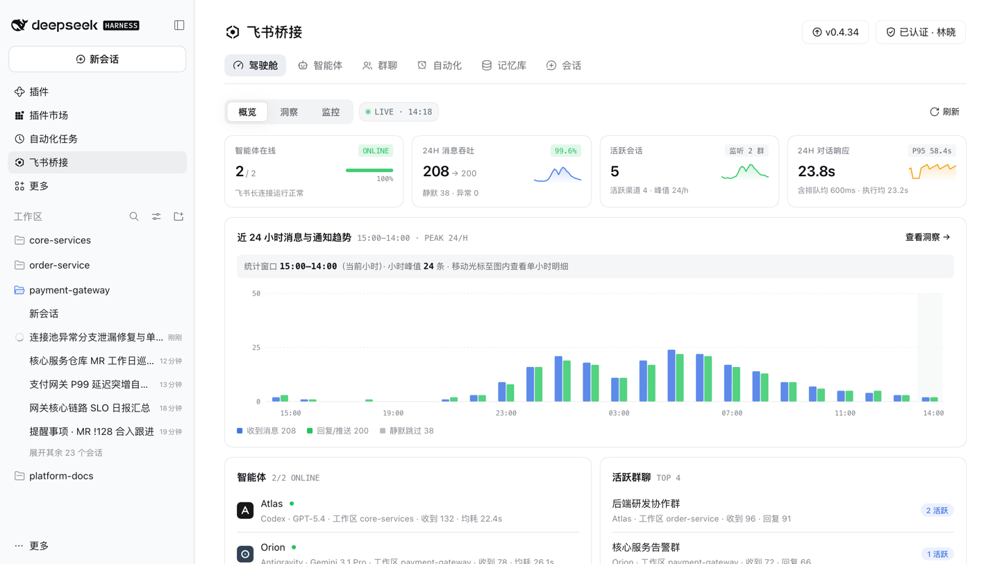
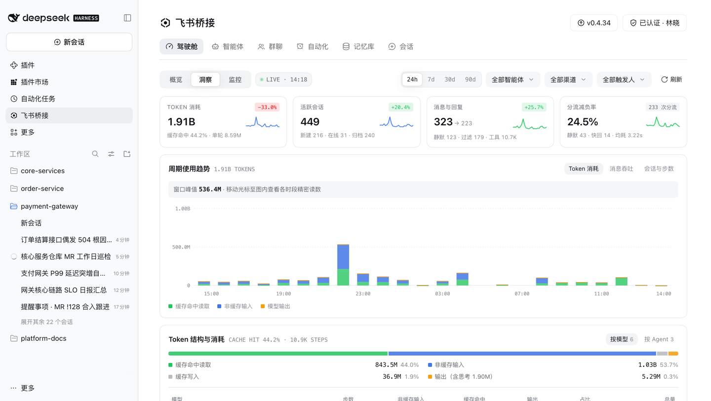
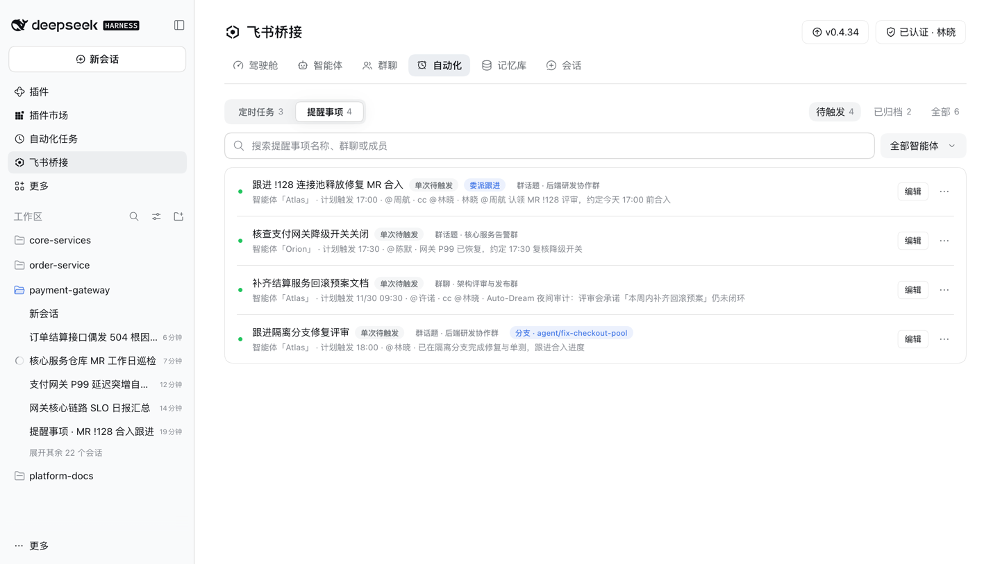
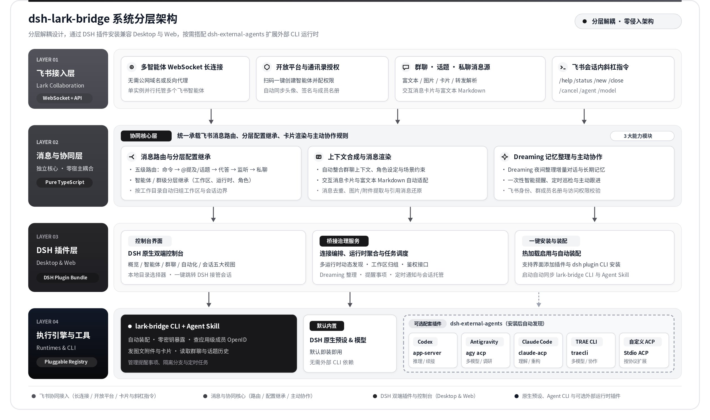
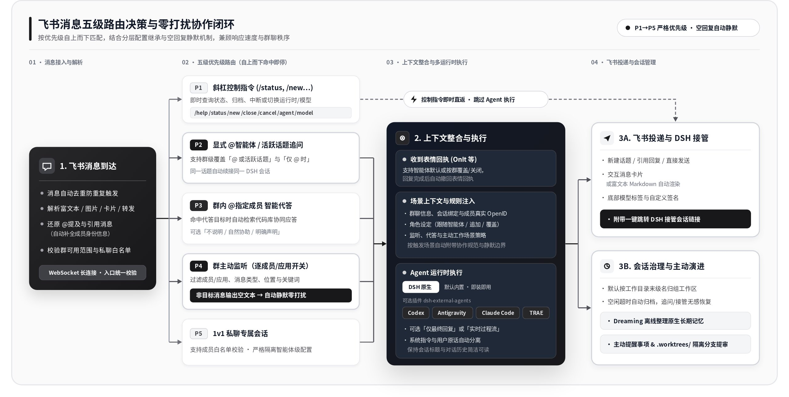

<div align="center">
  
  <h1>dsh-lark-bridge</h1>
  <p><strong>Turn Claude Code, Codex, TRAE & DeepSeek Harness into a 24/7 Feishu/Lark team member:<br/>Zero public server · Smart triage (zero spam) · Nightly Auto-Dream memory · Proactive follow-ups</strong></p>
  <p>
    <a href="https://github.com/harryzhz/dsh-lark-bridge/releases/latest"></a>
    <a href="./LICENSE"></a>
    <a href="https://github.com/harryzhz/dsh-lark-bridge/stargazers"></a>
    
  </p>
  <p>
    <a href="./README.md">简体中文</a> · <strong>English</strong>
  </p>
  <p>
    <a href="#demo">Demo</a> ·
    <a href="#quick-start-3-minutes">3-Min Setup</a> ·
    <a href="#why-more-than-a-chat-bridge">Why This?</a> ·
    <a href="#real-world-use-cases">Use Cases</a> ·
    <a href="#architecture--key-features">Features</a> ·
    <a href="./docs/README.md">Docs</a>
  </p>
</div>

> Built for [DeepSeek Harness (DSH)](https://github.com/deepseek-ai/deepseek-harness) (Desktop & Web), inspired by [dsh-superagent](https://github.com/deepseek-ai/dsh-superagent-prototype) and [botmux](https://github.com/deepcoldy/botmux). Works out of the box with DSH native presets; paired automatically with [dsh-external-agents](https://github.com/harryzhz/dsh-external-agents) via the one-line installer to run **Claude Code, Codex, Antigravity, and TRAE CLI** right inside your Feishu/Lark groups. Open-sourced under **MIT**.

---

## Why More Than a Chat Bridge?

Most Feishu/Lark bridges simply forward `@mention` messages to a local CLI. In real engineering groups, what makes teammates actually keep an AI bot around every day is **knowing when to stay quiet, remembering team conventions, and following through on commitments**:

| Typical Feishu/Lark Bridge | `harryzhz/dsh-lark-bridge` |
| --- | --- |
| **Either silent until `@mentioned`, or spams every casual "OK / +1" message** | **Smart Triage + Per-Member/App Active Listening**: stays 100% quiet during human banter, wakes up instantly on alert cards to inspect local repos and post root-cause threads, with mention-free follow-ups inside active threads. |
| **Forgets everything once the chat ends** | **Cross-Runtime Long-Term Memory + Nightly Auto-Dream**: say "remember…" in chat to store rules in SQLite + FTS5 with a visual Knowledge Graph; nightly Auto-Dream reviews new chats, verifies stale facts against code, and supersedes outdated rules. |
| **Action items like `A @ B merge this MR before 6pm` vanish in scrollback** | **Silent Delegation Tracking**: automatically tracks peer commitments, checks real chat/MR/CI status when due — **archives silently if already resolved, or nudges `@owner cc initiator` only if still open**. |
| **Edits dirty your main branch; plugin upgrades kill active runs** | **Isolated `.worktrees/` PR Flow + Observability Cockpit + Zero-Restart Hot Updates**: optional isolated worktree fixes, full token/latency/triage cockpit, and one-click hot updates from GitHub Releases without dropping live sessions. |

---

## Demo

https://github.com/user-attachments/assets/3f02edff-d477-49dc-a515-fc3820231f71

> **What's inside**: QR-code one-click bot creation → `@mention` code debugging & 1-click handoff back to DSH → zero-mention alert-group triage → `A @ B` delegation reminders → Obsidian-style Memory Graph & Auto-Dream → Observability Cockpit.

<table>
  <tr>
    <td width="50%">
      
      <p align="center"><sub><strong>Cockpit · Overview</strong>: Live bot health, 24h message throughput, response stats & active groups</sub></p>
    </td>
    <td width="50%">
      
      <p align="center"><sub><strong>Cockpit · Insights</strong>: Token breakdown, cache hit rate, per-model/agent cost & triage funnel</sub></p>
    </td>
  </tr>
  <tr>
    <td width="50%">
      
      <p align="center"><sub><strong>Memory · Knowledge Graph</strong>: Tag hubs, semantic edges & temporal evolution playback</sub></p>
    </td>
    <td width="50%">
      
      <p align="center"><sub><strong>Automation · Reminders</strong>: Delegation tracking, Auto-Dream audits & worktree badges</sub></p>
    </td>
  </tr>
</table>

---

## Quick Start (3 Minutes)

**No cloud server, no public domain, no webhook tunnel required** — powered by official Feishu/Lark WebSocket long connections. One command installs **DSH + `dsh-lark-bridge` + `dsh-external-agents`** on macOS, Windows, or Linux (safely reuses existing DSH installations without touching credentials):

#### macOS / Linux

```bash
# Interactive mode: choose Desktop App / standalone Web service / both (Linux defaults to Web)
curl -fsSL https://raw.githubusercontent.com/harryzhz/dsh-lark-bridge/main/scripts/install.sh | bash

# Specify mode directly (add -y for non-interactive)
curl -fsSL https://raw.githubusercontent.com/harryzhz/dsh-lark-bridge/main/scripts/install.sh | bash -s -- --mode app
curl -fsSL https://raw.githubusercontent.com/harryzhz/dsh-lark-bridge/main/scripts/install.sh | bash -s -- --mode web
```

#### Windows (PowerShell)

```powershell
# Interactive mode
irm https://raw.githubusercontent.com/harryzhz/dsh-lark-bridge/main/scripts/install.ps1 | iex

# Specify mode directly (app / web / both)
$env:DSH_INSTALL_MODE = 'app'; irm https://raw.githubusercontent.com/harryzhz/dsh-lark-bridge/main/scripts/install.ps1 | iex
```

### Connect to Feishu / Lark in 3 Steps

1. **Open Console**: In DSH Desktop, click **Lark Bridge** in the sidebar; for standalone Web, run `dsh web` (or `dsh --profile web --no-open --port 3880`).
2. **QR One-Click Bot Setup**: Click **Lark Auth** in the top-right to sign in with mobile Feishu/Lark → **Bots → New Bot** → enter name, default workspace directory, and runtime (DSH / Claude Code / Codex / TRAE) → scan to auto-create the app, grant scopes, and connect WebSocket (existing apps are also supported).
3. **Invite to a Group**: Add the bot to any Feishu/Lark group — it auto-enables and greets the group, ready for immediate `@mention` or fine-grained per-group rules.

<details>
<summary>Expand: Manual installation (UI / <code>dsh plugin</code> CLI), installer flags & zero-restart hot updates</summary>

#### Prerequisites
- `DeepSeek Harness >= 0.2.2-rc.5` (Desktop App ships its own runtime; standalone Web requires `Node.js >= 22.13.0`).

#### Manual Install via DSH UI
1. Go to **Plugins → Add Plugin**.
2. Install from GitHub Release `.tgz` (recommended, no build scripts needed):
   - Bridge: `https://github.com/harryzhz/dsh-lark-bridge/releases/latest/download/dsh-lark-bridge.tgz`
   - External CLI runtimes (optional): `https://github.com/harryzhz/dsh-external-agents/releases/latest/download/dsh-external-agents.tgz`
3. Click **Enable** (restart DSH once after adding `dsh-external-agents`).

#### Manual Install via CLI (Web Profile)
```bash
dsh plugin --profile web add \
  https://github.com/harryzhz/dsh-external-agents/releases/latest/download/dsh-external-agents.tgz \
  https://github.com/harryzhz/dsh-lark-bridge/releases/latest/download/dsh-lark-bridge.tgz
```

#### Zero-Restart Hot Updates
- Click the version badge in the top-right corner of the console or run `lark-bridge plugin update` to update in place without restarting DSH Web or dropping active turns.
- When restarting the host is needed, run `lark-bridge lifecycle drain --wait --reason "upgrade"` first to drain in-flight conversations cleanly.

</details>

---

## Real-World Use Cases

| Use Case | Recommended Setup | Outcome |
| --- | --- | --- |
| **Engineering Group Copilot** | Bind repo per group · Thread replies + topic reuse · Native thinking bubbles on | `@Bot` inspects commits, traces bugs, runs tests in a clean thread; 1-click link opens the exact session in DSH. |
| **24/7 On-Call Alert Triage** | Enable **Active Listening → Alert Triage** template for alert bots only | Zero noise during human discussion; P0/P1 alert cards immediately trigger a thread with mitigation & root cause. |
| **Zero-Drop Delegation Follow-Up** | Enable **Proactive Reminders + Delegation Tracking + Quiet Hours** | Quietly tracks `A @ B` commitments; checks actual MR/CI/chat state when due and only nudges if still unresolved. |
| **Self-Updating Team Memory** | Enable **Dreaming & Long-Term Memory** + pin key conventions | Say "remember…" once; nightly Auto-Dream consolidates lessons and verifies facts against the latest codebase. |
| **Silent Daily Patrols** | Bind DSH schedules to groups with **Notify only on findings/errors** | Completely silent when everything is healthy; sends rich cards with `@mentions` only when blockers or anomalies appear. |
| **Busy Lead Proxy Replies** | Configure **Permissions & Proxy** for a tech lead with thread continuation | Answers code/API questions directed at `@Lead` with verified repo evidence while leaving high-risk decisions to the human. |

---

## Architecture & Key Features

### Layered Architecture & 5-Stage Routing



Every inbound message passes through deduplication, rich-media/quote hydration, and a 5-stage routing pipeline with lightweight pre-triage so the bot speaks only when helpful:



### Highlights

- **6-Tab Adaptive Console (Light / Dark + Wide Mode)**:
  - **Cockpit** (Overview / Insights / Monitor: throughput, token & cache economics, triage savings, P50/P95 latency, WebSocket ACK & SQLite WAL health)
  - **Bots** (QR onboarding, multi-bot connection pool, reconnect, profile sync)
  - **Groups** (Per-group repo binding, runtime/model overrides, AI-generated custom roles & active-listening templates)
  - **Automation** (Multi-group scheduled patrols + unified proactive reminder queue)
  - **Memory** (Obsidian-style interactive Knowledge Graph + bi-temporal list view with `supersede` history)
  - **Sessions** (Unified view of chat sessions, triage decisions, and Auto-Dream runs)
- **Native Feishu/Lark Experience**: Streaming native Chain-of-Thought thinking bubbles (`/cot`), inline slash commands (`/status`, `/new`, `/cancel`, `/agent`, `/model`, `/console`), and auto-provisioned `lark-bridge` CLI + `SKILL.md` for rich cards, attachments, history, memory, reminders, and isolated Git worktrees.

---

## Development & Build

```bash
pnpm install
pnpm build && pnpm typecheck && pnpm test && pnpm run check:privacy

# Build release tarball (.local/releases/)
pnpm run pack:bundle
```

For architecture and contributor guidelines, see [docs/README.md](./docs/README.md) and [SECURITY.md](./SECURITY.md).

## License

[MIT](./LICENSE)
