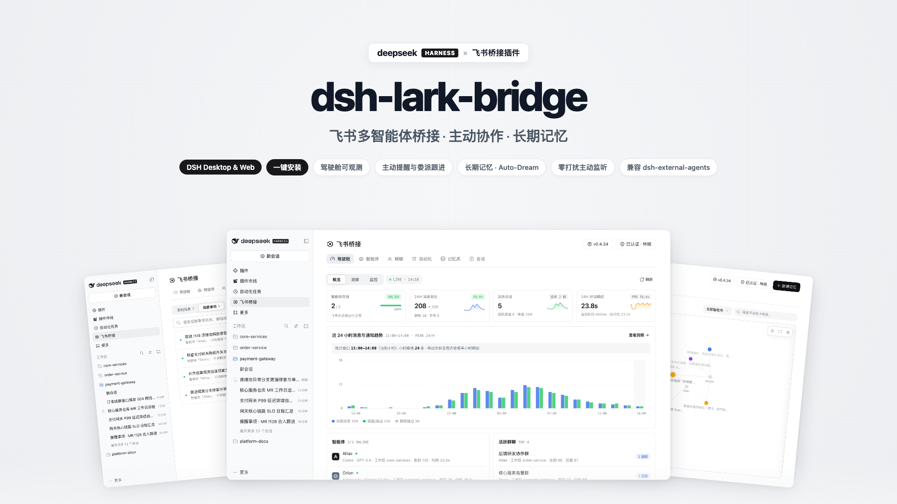
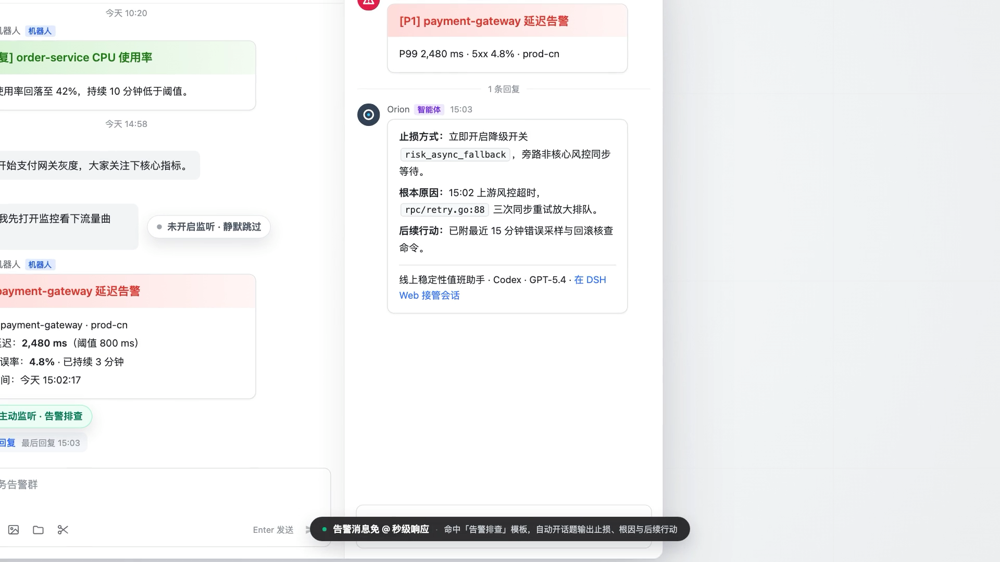
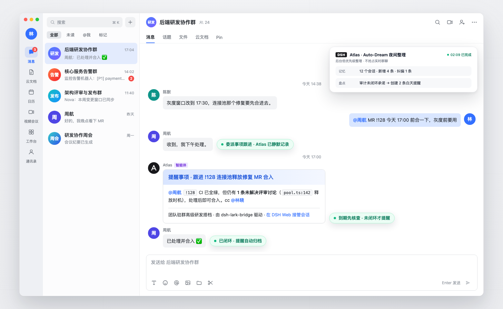
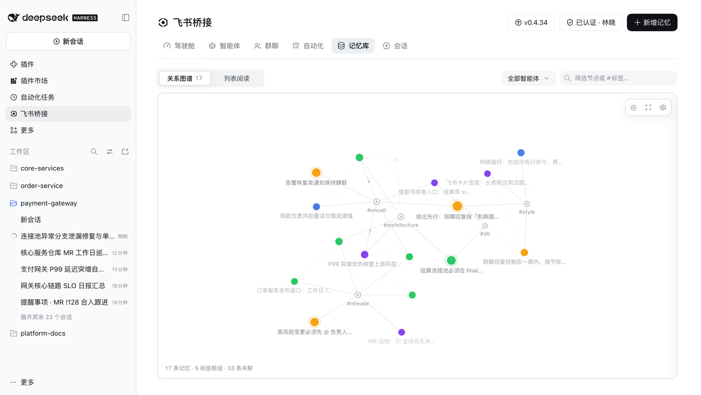

<div align="center">
  
  <h1>dsh-lark-bridge</h1>
  <p><strong>Bring Claude Code, Codex, TRAE & DeepSeek Harness into Feishu/Lark groups:<br/>Zero public server · Smart triage (zero spam) · Nightly Auto-Dream memory · Proactive follow-ups</strong></p>
  <p>
    <a href="https://github.com/harryzhz/dsh-lark-bridge/releases/latest"></a>
    <a href="./LICENSE"></a>
    <a href="https://github.com/harryzhz/dsh-lark-bridge/stargazers"></a>
    
  </p>
  <p>
    <a href="./README.md">简体中文</a> · <strong>English</strong>
  </p>
  <p>
    <a href="#key-highlights">Highlights</a> ·
    <a href="#demo">Demo</a> ·
    <a href="#quick-start-3-minutes">3-Min Setup</a> ·
    <a href="#real-world-use-cases">Use Cases</a> ·
    <a href="./docs/README.md">Docs</a>
  </p>
</div>

> Built for [DeepSeek Harness (DSH)](https://github.com/deepseek-ai/deepseek-harness) (Desktop & Web), inspired by [dsh-superagent](https://github.com/deepseek-ai/dsh-superagent-prototype) and [botmux](https://github.com/deepcoldy/botmux). Works out of the box with DSH native presets; paired automatically with [dsh-external-agents](https://github.com/harryzhz/dsh-external-agents) via the one-line installer to run **Claude Code, Codex, Antigravity, and TRAE CLI** inside your Feishu/Lark groups. Open-sourced under **MIT**.

---

## Key Highlights

1. **Zero Public Server — Ready in 3 Minutes**
   Powered by official Feishu/Lark WebSocket long connections — no cloud VM, public domain, or webhook tunnel needed. One command installs everything; scan a QR code in the console to auto-create the app, grant permissions, and connect.
2. **Multi-Engine, Per-Group Configuration**
   Uses DSH native presets by default and seamlessly adds **Claude Code, Codex, Antigravity, and TRAE CLI** via [dsh-external-agents](https://github.com/harryzhz/dsh-external-agents). Bind each group to its own repo, runtime, model, concurrency cap, and role prompt — with AI-assisted custom role & listener template generation.
3. **Zero-Spam Smart Triage & Active Listening**
   Lightweight pre-triage + per-member/app listening toggles keep the bot 100% quiet during human banter, while waking up immediately on alert cards to inspect local repos and reply in a clean thread with mitigation & root cause. Supports **native Feishu thinking bubbles**, mention-free thread follow-ups, and 1-click handoff back to DSH.
4. **Cross-Runtime Long-Term Memory + Nightly Auto-Dream**
   Stores team conventions in a unified SQLite + FTS5 engine with an Obsidian-style **Knowledge Graph**, isolated across global / workspace / chat scopes. Every night, **Auto-Dream** reviews new chats, verifies memories against the latest codebase, and supersedes stale facts.
5. **Proactive Delegation Follow-Ups & Isolated `.worktrees/` Fixes**
   Quietly tracks peer `A @ B` commitments and checks actual chat/MR/CI state when due — **archives silently if already done, nudges `@owner cc initiator` only if still open**, respecting quiet hours. Optional isolated Git worktree fixes let the agent patch code, run tests, and open PRs without touching your main branch.
6. **Observability Cockpit & Zero-Restart Hot Updates**
   Built-in **Cockpit (Overview / Insights / Monitor)** tracks throughput, token & cache economics, triage savings, P50/P95 latency, and SQLite WAL health. Standalone Web supports one-click **zero-restart hot updates** from GitHub Releases without dropping live turns.

---

## Demo

<div align="center">
  <a href="https://drive.google.com/file/d/1pjdbF6pjJ9ZZGqx8MDeb8X0NV1D_XMmo/view?usp=drive_link">
    
  </a>
  <p>
    ▶️ <a href="https://drive.google.com/file/d/1pjdbF6pjJ9ZZGqx8MDeb8X0NV1D_XMmo/view?usp=drive_link"><strong>Watch Full Product Demo Video Online (v5 · 1080p · 2m 33s)</strong></a>
  </p>
  <p><sub>Covers: QR one-click bot setup · <code>@mention</code> repo debugging & DSH handoff · Zero-mention alert triage · Scheduled patrol cards · <code>A @ B</code> delegation & Auto-Dream audits · Memory Knowledge Graph · Observability Cockpit</sub></p>
</div>

<table>
  <tr>
    <td width="50%">
      
      <p align="center"><sub><strong>Zero-Spam Active Listening</strong>: Skips human banter; immediately triages P1 alert cards in a thread</sub></p>
    </td>
    <td width="50%">
      
      <p align="center"><sub><strong>Delegation & Nightly Audits</strong>: Checks real status and nudges open commitments during work hours</sub></p>
    </td>
  </tr>
  <tr>
    <td width="50%">
      
      <p align="center"><sub><strong>Memory · Knowledge Graph</strong>: Cross-runtime team memory network with evolution playback</sub></p>
    </td>
    <td width="50%">
      
      <p align="center"><sub><strong>Cockpit · Overview / Insights / Monitor</strong>: Throughput, token cache, triage savings & SLA</sub></p>
    </td>
  </tr>
</table>

---

## Quick Start (3 Minutes)

One command installs **DSH + `dsh-lark-bridge` + `dsh-external-agents`** on macOS, Windows, or Linux (safely reuses existing DSH installations without touching credentials):

#### macOS / Linux

```bash
# Interactive mode: choose Desktop App / standalone Web service / both (Linux defaults to Web)
curl -fsSL https://raw.githubusercontent.com/harryzhz/dsh-lark-bridge/main/scripts/install.sh | bash

# Specify mode directly (add -y for non-interactive)
curl -fsSL https://raw.githubusercontent.com/harryzhz/dsh-lark-bridge/main/scripts/install.sh | bash -s -- --mode app
curl -fsSL https://raw.githubusercontent.com/harryzhz/dsh-lark-bridge/main/scripts/install.sh | bash -s -- --mode web
```

#### Windows (PowerShell)

```powershell
# Interactive mode
irm https://raw.githubusercontent.com/harryzhz/dsh-lark-bridge/main/scripts/install.ps1 | iex

# Specify mode directly (app / web / both)
$env:DSH_INSTALL_MODE = 'app'; irm https://raw.githubusercontent.com/harryzhz/dsh-lark-bridge/main/scripts/install.ps1 | iex
```

### Connect to Feishu / Lark in 3 Steps

1. **Open Console**: Click **Lark Bridge** in DSH Desktop, or run `dsh web` (or `dsh --profile web --no-open --port 3880`) for standalone Web.
2. **QR One-Click Bot Setup**: Click **Lark Auth** to sign in with mobile Feishu/Lark → **Bots → New Bot** → enter name, workspace directory, and runtime → scan to auto-create the app and connect WebSocket.
3. **Invite to a Group**: Add the bot to any group — it auto-enables and greets the team, ready for immediate use.

<details>
<summary>Expand: Manual installation (UI / <code>dsh plugin</code> CLI) & zero-restart hot updates</summary>

- **Prerequisites**: `DeepSeek Harness >= 0.2.2-rc.5` (standalone Web requires `Node.js >= 22.13.0`).
- **DSH UI**: **Plugins → Add Plugin**, install from `.tgz`:
  - `https://github.com/harryzhz/dsh-lark-bridge/releases/latest/download/dsh-lark-bridge.tgz`
  - `https://github.com/harryzhz/dsh-external-agents/releases/latest/download/dsh-external-agents.tgz` (optional)
- **CLI (Web Profile)**:
  ```bash
  dsh plugin --profile web add \
    https://github.com/harryzhz/dsh-external-agents/releases/latest/download/dsh-external-agents.tgz \
    https://github.com/harryzhz/dsh-lark-bridge/releases/latest/download/dsh-lark-bridge.tgz
  ```
- **Hot Updates**: Click the top-right version badge in the console or run `lark-bridge plugin update` to update without restarting DSH Web.

</details>

---

## Real-World Use Cases

| Use Case | Recommended Setup | Outcome |
| --- | --- | --- |
| **Engineering Group Copilot** | Bind repo per group · Thread replies + topic reuse · Native thinking bubbles | `@Bot` traces commits, debugs issues, runs tests in a clean thread; 1-click link opens the session in DSH. |
| **24/7 On-Call Alert Triage** | Enable **Active Listening → Alert Triage** for alert bots only | Zero noise during human discussion; P0/P1 alerts trigger a thread with mitigation & root cause. |
| **Zero-Drop Delegation Follow-Up** | Enable **Proactive Reminders + Delegation Tracking + Quiet Hours** | Quietly tracks `A @ B` commitments; checks real MR/CI/chat state and nudges only if still open. |
| **Self-Updating Team Memory** | Enable **Dreaming & Long-Term Memory** + pin key conventions | Say "remember…" once; nightly Auto-Dream consolidates lessons and verifies facts against code. |
| **Silent Daily Patrols** | Bind DSH schedules with **Notify only on findings/errors** | Silent when healthy; sends rich cards with `@mentions` only when blockers or anomalies appear. |
| **Busy Lead Proxy Replies** | Configure **Permissions & Proxy** for a tech lead with thread continuation | Answers `@Lead` code/API questions with verified repo evidence while leaving high-risk calls to the lead. |

---

## Documentation & Development

For full system architecture, routing internals, memory/Auto-Dream design, CLI reference, and contributor guidelines, see **[docs/README.md](./docs/README.md)** ([Architecture](./docs/architecture/overview.md) · [Sessions & Routing](./docs/architecture/session-management.md) · [Memory & Auto-Dream](./docs/architecture/memory-and-dreaming.md) · [Security](./SECURITY.md)).

```bash
pnpm install
pnpm build && pnpm typecheck && pnpm test && pnpm run check:privacy
```

## License

[MIT](./LICENSE)
