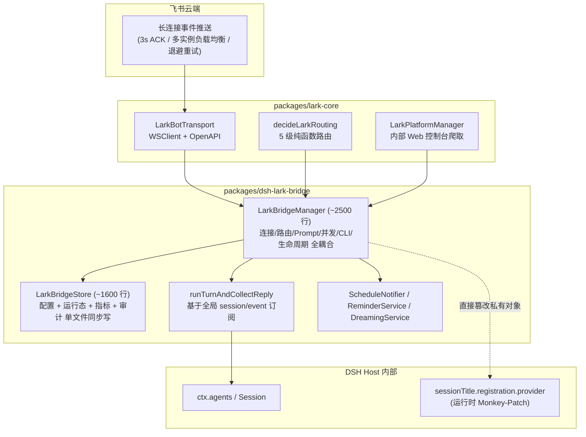
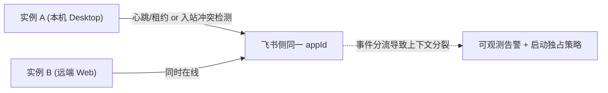

# 架构设计全面审查与演进建议

本文档记录对 `dsh-lark-bridge` 现有架构的系统性审查结果：从生产故障（空消息、双回复、会话生命周期漂移、状态回滚）反推底层结构性根因，梳理当前 7 项中长期架构债与分阶段演进建议。

> [!NOTE]
> 本文档聚焦**中长期结构性设计问题**；排查过程中定位到的确定性功能缺陷（零宽字符空回复、飞书 3 秒 ACK 超时重投、并发 `WSClient` 泄漏、同会话并发 `turn` 抢占、`runtimeProfileId` 重载丢失、`active-thread` 回复模式误覆盖等）已在当前分支中先行修复并补齐回归测试。

---

## 1. 现状全景与问题拓扑

---

## 2. 七大核心架构问题清单

### 问题 1：核心编排层与存储层“上帝对象”化（职责边界模糊）

- **现状**：
  - `LarkBridgeManager`（~2,500 行）同时承担 8 类正交职责：Bot 连接生命周期管理、入站消息分发、同会话并发队列与 `AgentHandle` 池、Prompt 与附件拼装、飞书回复投递与话题别名追踪、CLI / HTTP 业务接口、开放平台 OAuth 与资料补全、历史会话对账与标题修复。
  - `LarkBridgeStore`（~1,600 行）同时充当配置仓储（Bot / Group / Template / ScheduleBinding）、易失运行态表（Bindings / PendingTurns / SeenMessages / DiscoveredChats）、时序指标与审计日志聚合器，以及面向前端的 ViewModel 投影器（`buildCockpitPayload` / `listGroupViews`）。
- **结构性代价**：
  - 任何局部需求（如增加一项提醒策略或修复话题路由）都需直接修改超大类，状态字段（`transports`、`handles`、`pendingAcquires`、`sessionTurnQueues`、`inFlightTurns`、`activeTurns`）共享同一实例命名空间，极易引入隐性竞态与回归。
  - 单元测试被迫构造庞大的 `fakeCtx` mock 整颗宿主对象树，难以独立验证子领域不变量。
- **演进方向**：将 `LarkBridgeManager` 拆分为 4 个高内聚协作者：
  1. `BotConnectionPool`：负责每个 Bot 的连接生命周期、串行 `syncBot`、健康状态与成员事件；
  2. `SessionCoordinator`（Per-Session Actor）：独占管理每个会话的创建、恢复、排队、中断、闲置归档与句柄回收；
  3. `InboundPipeline`：负责去重、路由决策、Prompt 合成、回复投递与话题拓扑别名更新；
  4. `AgentToolFacade`：面向 `lark-bridge` CLI 与 HTTP API 的只读/主动发送门面。

---

### 问题 2：全量同步写盘导致的持久化写放大与可靠性隐患

- **现状**：
  - `LarkBridgeStore.persist()` 将所有配置、运行态绑定、48 小时桶指标、200 条审计事件、600 条历史会话索引及去重记录打包为单一 JSON 文件（线上实测超过 300 KB），每次微小的状态变更都同步执行 `JSON.stringify` + `writeFileSync` + `renameSync`。
  - **单轮对话实测写盘次数**：入站指标（1）→ 写入 `pendingTurn`（2）→ `acquireAgent` 写入 `managedSession` + `binding`（3~4）→ 入站审计事件（5）→ 回填 `pendingTurn.sessionId`（6）→ 清除 `pendingTurn`（7）→ `touchBinding` / `touchManagedSession` / `markBindingReplied`（8~10）→ 写入 `aliasRouteKeys` + 回复指标 + 审计事件（11~13）。**一条消息可触发 10+ 次主线程同步全量写盘**。
  - **数据分层缺失**：低频高价值的**配置数据**（Bot 密钥、群规则、定时绑定）与高频易失的**遥测/运行态数据**（指标、审计日志、去重集合、活跃绑定）混存于同一文件，一旦高频写盘异常或磁盘满，极易牵连核心配置。
- **演进方向**：
  - **物理拆仓**：将 `$DSH_HOME/lark-bridge/` 拆分为三类存储：
    - `config.json`（低频、强一致、版本化 schema + 写前备份，仅存 Bot / Group / Template / ScheduleBinding）；
    - `runtime.json`（或 SQLite WAL：`state.db`），存 Bindings / PendingTurns / Reminders / SeenMessages，支持防抖刷盘与事务；
    - `telemetry.jsonl` / 环形日志，异步追加审计事件与聚合指标，完全脱离同步关键路径。
  - **防抖合并写（Coalesced Flush）**：同一事件循环内的多次运行态更新合并为一次刷盘，仅在关键状态点（如 `pendingTurn` 落盘、配置保存）强制同步 fsync。

---

### 问题 3：单 `appId` 多实例连接脑裂（Split-Brain）无感知、无仲裁

- **现状**：
  - 飞书开放平台允许同一个 `appId` 在多台机器或多个进程（例如同时运行 DSH Desktop 与远端 DSH Web 服务）同时建立 WebSocket 长连接。飞书服务端会对多连接做事件分发，且在任一连接超过 3 秒未 ACK 时将**同一条消息重试投递到另一台实例**。
  - 当前虽然已通过“非阻塞异步 <5ms ACK + 本地 24h 持久化去重”消除了单实例重试与超时重投，但**如果用户同时在两台设备运行同一 `appId` 的 Bot**，两台设备仍会互相抢占事件流、拥有各自独立的本地会话上下文，并在配置不同时表现出随机切换模型/回复模式的诡异行为。
- **演进方向**：

  1. **本机同目录多进程互斥**：在 `$DSH_HOME/lark-bridge/` 引入基于锁文件/PID 探活的实例锁，防止本机误启双进程竞争同一配置与状态文件；
  2. **跨主机同 `appId` 冲突探测与告警**：在 Bot 绑定群内观测到 `senderOpenId === self.botOpenId` 且消息 ID 不在本实例近期发出的 `sentMessageIds` 缓存中（或检测到来自同 `appId` 的异常回复）时，立即在控制台与审计日志弹出明确的多实例冲突警告，引导用户关闭多余实例或为不同环境分配独立测试 App；
  3. **可选的共享去重/租约后端接口**：为团队服务器部署预留可插拔的协调接口（如 Redis / SQLite 共享卷），保持个人单机零依赖。

---

### 问题 4：会话并发控制分散，缺少统一的 Per-Session Actor 状态机

- **现状**：
  - 当前围绕一个 `sessionId` 存在多条并发修改路径：`handleInbound`（新消息 / 跟进消息）、`acquireAgent`（首次建会话 / 热切模型 / 切运行时解绑）、`/cancel` 与 `/new` 斜杠命令、`sweepIdleBindings`（空闲归档）、`unbindRoute`（手动关闭）、`stop()`（优雅停机）。
  - 尽管本次修复已引入 `sessionTurnQueues` 解决同会话消息并发执行碰撞，但 `/new`、`unbindRoute`、热切配置与空闲扫描仍直接操作共享 `handles` 与 `bindings` Map，仍存在诸如“空闲归档瞬间恰有新消息正在 `buildPrompt`”的极窄窗口竞态。
- **演进方向**：
  - 将每个活跃会话抽象为独立的 `SessionActor`（显式状态机：`creating -> idle -> running -> closing -> archived`），所有操作（`submitTurn`、`switchModel`、`cancel`、`unbind`、`idleSweep`）统一作为命令投递到该会话的邮箱队列，由单一状态机顺序处理并维护不变量：
    - `running` 状态下禁止空闲归档；
    - `closing` 状态下新消息自动路由到重建流程，不复用垂死句柄。

---

### 问题 5：基于自然语言 Prompt 的控制协议过于脆弱

- **现状**：
  - 旁听静默（Listener）、定时静默（Schedule `non_empty` / `error_only`）、提醒静默（Reminder）高度依赖在 Prompt 中嘱咐模型“无需回复时输出空文本 / 特殊哨兵”。
  - 不同模型家族对“空输出”和“哨兵标签”的遵循差异极大：例如部分模型在工具调用后无法产出 0 字节文本，会自动补发 `\u200b`（零宽空格），或将标签包裹在代码块/说明语句中；本次已通过 `normalizeReplyText` 清洗不可见字符 + 统一 `<no_reply/>` 哨兵完成防御，但本质上仍属于“从非结构化文本解析控制意图”。
- **演进方向**：
  - 统一所有后台/静默决策场景的协议层：
    - **短期**（已落地）：全链路统一 `<no_reply/>` / `<no_reminder_needed/>` 哨兵 + 不可见字符剥离 + 传输层防空消息门禁；
    - **长期**：对于支持工具调用的 Agent 运行时，提供显式结构化控制工具（如 `lark-bridge decide --silent` 或原生工具 `skip_reply(reason)`），将“控制面决策”与“数据面正文输出”彻底解耦，避免模型把内部思考或拒答解释误发到飞书群。

---

### 问题 6：对宿主私有实现与非公开外部接口的脆弱耦合

- **现状**：
  - **宿主内部 Monkey-Patch**：
    - `bridge-manager.ts` 的 `installSessionTitleGuard()` 直接读写 `ctx.get('sessionTitle').registration.provider.generate` 并挂载 `__larkSanitized` 篡改宿主方法；
    - `dsh-lark-ui` 的 `session-model-filter.ts` 覆写并拦截运行时目录解析内部钩子。
    - 宿主（`@deepseek-ai/dsh-*`）任何非破坏性内部重构都可能导致静默失效或运行时异常。
  - **飞书开发者后台私有 Web 接口爬取**：
    - `packages/lark-core/src/open-platform.ts` 通过模拟登录 Cookie Jar 访问飞书开发者后台未公开 Web 接口实现一键创建应用与查询资料，上游页面或风控策略变更随时可能中断自动化建应用流程。
- **演进方向**：
  - 推动在 DSH Host 侧提供正式的标题过滤/Prompt 预处理扩展点（或标准 `session/title` 拦截钩子），移除对 `registration.provider` 的反射篡改；
  - 将 `open-platform.ts` 隔离为明确标记为“实验性快捷向导（Best-Effort）”的可选适配器，确保其失效时绝不影响核心手动凭证配置与长连接收发链路，并在 UI 清晰提示降级路径。

---

### 问题 7：结构化可观测性、健康自检与错误边界不足

- **现状**：
  - 飞书 SDK（`@larksuiteoapi/node-sdk`）在部分权限不足场景（如通讯录范围 `41050`、应用信息接口 `99992402`）直接向 `stdout`/`stderr` 打印非结构化对象，缺少 `botId` / `chatId` / `messageId` / `sessionId` 关联追踪字段（Correlation ID），排查线上问题需手工跨 `dsh-web.stdout.log`、`lark-bridge-state.json` 和 `session.v4.jsonl.zstd` 三处拼接时间线。
  - 缺少独立的“自检/诊断（Doctor）”能力来一次性核验：长连接 ACK 延迟、是否存在重复 `appId` 冲突、必备飞书权限清单、事件订阅是否完整、磁盘状态文件健康度。
- **演进方向**：
  - 为每条入站消息生成统一的 `traceId`（关联 `botId` + `messageId` + `sessionId` + `turn`），贯穿 Transport → Router → TurnRunner → Delivery 全链路日志与审计事件；
  - 封装飞书 SDK 自定义 logger 适配器，统一按模块与脱敏级别输出结构化日志，并将常见错误码（`41050`、`99992402`、`230002` 等）翻译为可执行排障提示；
  - 增加 `lark-bridge doctor` / 控制台诊断面板，提供一键自检连通性、权限完整度与多实例冲突状态。

---

## 3. 分阶段演进路线图

| 阶段 | 优先级 | 目标改造项 | 预期收益 |
| --- | --- | --- | --- |
| **Phase 1（已完成）** | P0 | 非阻塞 <5ms ACK、24h 持久化去重、不可见字符与 `<no_reply/>` 全链路防御、同会话 FIFO 串行队列、并发 `syncBot`/`WSClient` 锁、`runtimeProfileId` 持久化 | 根治线上空白气泡、双回复、重启丢绑定、并发串台 |
| **Phase 2（近期）** | P1 | 存储拆分（`config.json` vs `runtime` vs `telemetry`）+ 防抖合并刷盘；本机实例锁 + 跨主机同 `appId` 冲突探测告警 | 主线程同步写盘降低 >85%；彻底消除配置损坏风险与多实例脑裂盲区 |
| **Phase 3（中期）** | P1 | 拆解 `LarkBridgeManager` 为 `BotConnectionPool` / `SessionActor` / `InboundPipeline` / `AgentToolFacade`；补齐全链路 `traceId` 与 `doctor` 自检 | 单模块 <500 行，彻底消除会话全生命周期边界竞态，排障效率提升一个量级 |
| **Phase 4（长期）** | P2 | 推动 DSH 原生扩展点替代 `sessionTitle` Monkey-Patch；探索工具化 `skip_reply` 控制协议 | 零私有 API 耦合，跨模型静默控制准确率逼近 100% |
