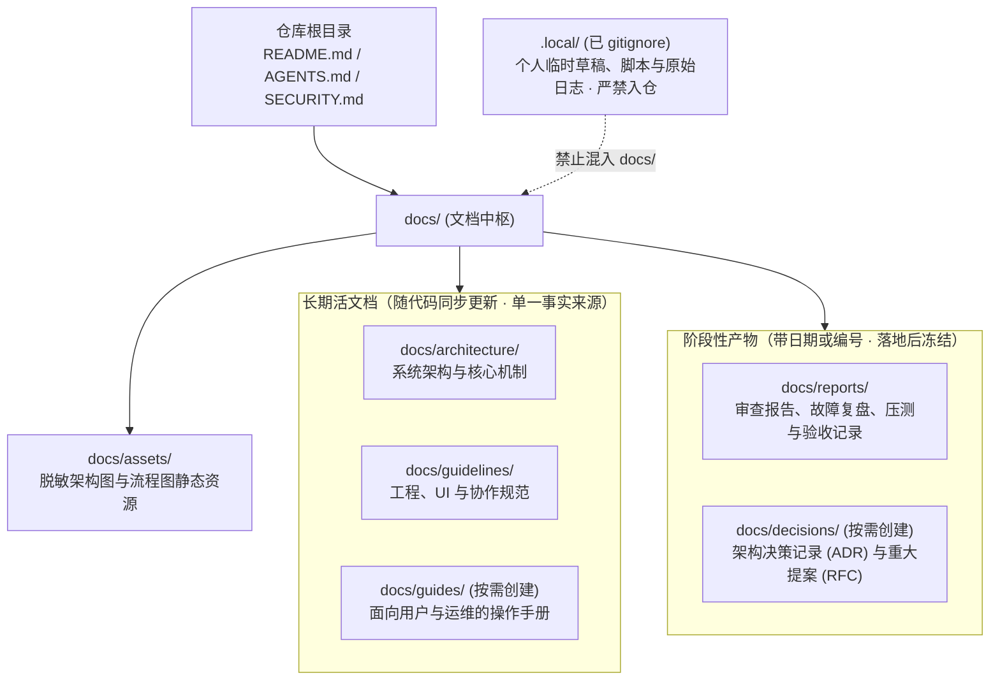

# 文档目录与维护约定

本目录按**生命周期与真相语义**组织 `dsh-lark-bridge` 的全部仓库内文档，明确区分**随代码同步演进的长期活文档**与**带时间戳、落地后冻结的阶段性产物**，避免历史审查或旧方案污染现行规范。

## 1. 目录拓扑与生命周期分类

## 2. 现行文档索引

### 长期活文档（Living Docs）

> 代码行为或工程约束发生变更时，必须在同一 PR 内同步更新对应文档。

| 分类 | 文档 | 适用场景与内容摘要 |
| --- | --- | --- |
| **系统架构** | [architecture/overview.md](./architecture/overview.md) | 六大模块防腐层分层、动态运行时发现、产物目录边界、HTTP/RPC 鉴权与 Desktop 会话接管约束 |
| **系统架构** | [architecture/session-management.md](./architecture/session-management.md) | 飞书消息拓扑与 `routeKey`、五级入站路由、多路由别名索引、`SessionActor` 生命周期状态机与场景示例 |
| **系统架构** | [architecture/memory-and-dreaming.md](./architecture/memory-and-dreaming.md) | 跨运行时 Memory 架构、四分类与三级隔离、SQLite v3/FTS5 与产物目录、两层渐进披露及 Auto-Dream 四阶段与诚信水位线 |
| **工程规范** | [guidelines/development.md](./guidelines/development.md) | Worktree + 分支 + PR 工作流、Commit 约定、常用验证/打包命令与开源隐私脱敏清单 |
| **工程规范** | [guidelines/ui.md](./guidelines/ui.md) | `packages/dsh-lark-ui` 设计令牌、控件右对齐、原位下钻子视图、防双层遮罩与标签流样式硬性规范 |

### 阶段性产物与历史记录（Point-in-time Artifacts）

> 记录特定时间点的审查结论、重构动机、故障复盘或技术选型背景；对应改动落地后即冻结为只读参考，不再代表当前代码现状。

| 日期 | 状态 | 文档 | 摘要 |
| --- | --- | --- | --- |
| `2026-11-23` | 已落地归档（PR #1 / #2） | [reports/2026-11-23-architecture-review.md](./reports/2026-11-23-architecture-review.md) | 七大结构性架构问题审查（上帝对象、JSON 写放大、多实例脑裂、会话状态机、结构化静默、宿主解耦与可观测性）与分阶段演进路线 |

### 仓库根目录保留文档

| 文档 | 保留原因 |
| --- | --- |
| [README.md](../README.md) | GitHub 仓库首页与安装/功能入口 |
| [AGENTS.md](../AGENTS.md) | AI 协作总控规则、核心红线与高频文档索引 |
| [SECURITY.md](../SECURITY.md) | GitHub 标准安全策略识别路径（运行期安全边界、防泄露基线与漏洞披露流程） |

## 3. 新增文档放置与命名规则

新增任何文档前，按下列决策顺序确定归属位置（**不提前创建空目录**，有实际文档时再建目录）：

| 文档类型 | 放置位置 | 命名约定 | 维护策略 |
| --- | --- | --- | --- |
| 系统架构、子系统设计、协议与存储模型 | `docs/architecture/` | `<topic>.md`（小写 kebab-case） | 长期维护，随代码变更同步更新 |
| 研发流程、代码/UI/测试/发版规范 | `docs/guidelines/` | `<topic>.md` | 长期维护，作为评审硬性约束 |
| 用户向或运维向操作手册（如迁移/排障/部署指南） | `docs/guides/` *(按需创建)* | `<topic>.md` | 长期维护，随 CLI/配置变更更新 |
| 架构审查、线上故障复盘（Postmortem）、压测/验收报告 | `docs/reports/` | `YYYY-MM-DD-<topic>.md` | 顶部标注日期/状态/关联 PR，完成后冻结 |
| 重大技术选型记录（ADR）或跨模块设计提案（RFC） | `docs/decisions/` *(按需创建)* | `NNNN-<topic>.md`（如 `0001-sqlite-wal.md`） | 顶部标注 `Proposed / Accepted / Superseded`，定案后只追加不改历史 |
| 图表与脱敏媒体资源 | `docs/assets/` | `<topic>.(png\|svg\|webp)` | 须过隐私检查，禁止含真实 ID/路径/账号 |
| 临时排查笔记、一次性验证脚本、原始日志、未脱敏数据 | `.local/`（已 gitignore） | 任意 | **严禁提交到 `docs/` 或版本库** |
