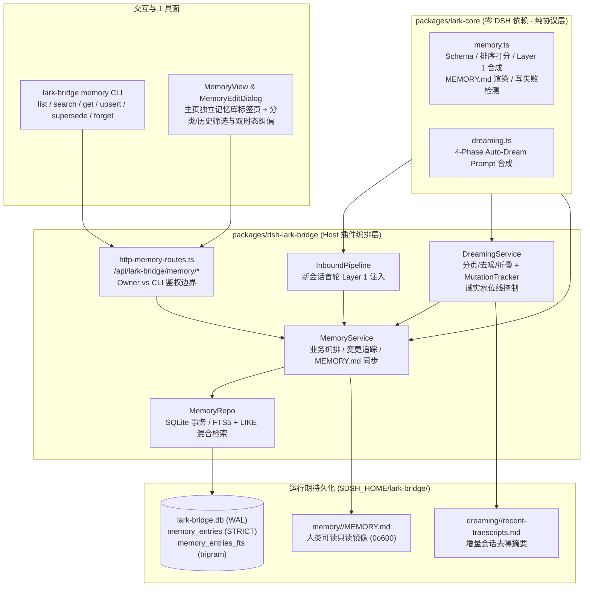
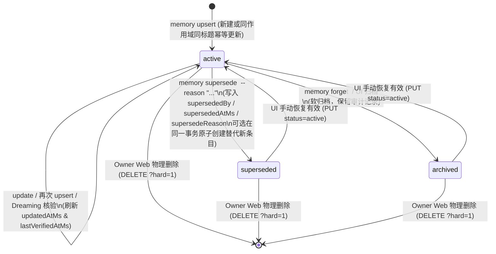
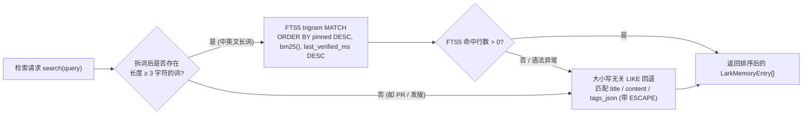
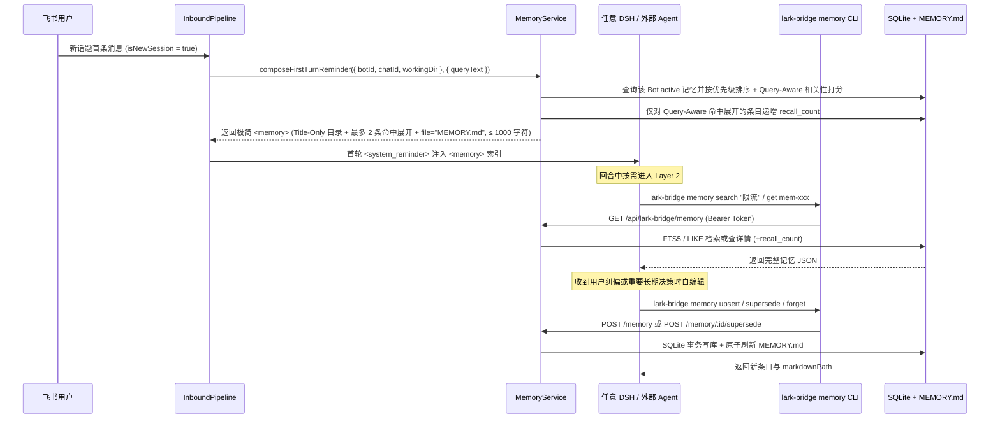
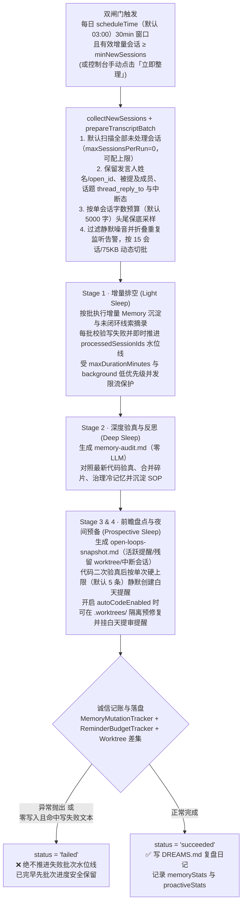

# Memory 与 Auto-Dream 架构实现

本文档说明 `dsh-lark-bridge` 跨运行时长期记忆（**Memory**）与离线整理（**Auto-Dream**）的整体架构、数据模型、存储与混合检索机制、两层渐进披露协议、鉴权边界及磁盘产物组织。

> 核心源码参考：
> - 领域协议与纯函数（零 DSH 依赖）：[packages/lark-core/src/memory.ts](../../packages/lark-core/src/memory.ts)、[packages/lark-core/src/dreaming.ts](../../packages/lark-core/src/dreaming.ts)
> - 存储迁移与仓储：[packages/dsh-lark-bridge/src/storage/migrations/003-memory.ts](../../packages/dsh-lark-bridge/src/storage/migrations/003-memory.ts)、[packages/dsh-lark-bridge/src/storage/memory-repo.ts](../../packages/dsh-lark-bridge/src/storage/memory-repo.ts)
> - 服务编排、首轮注入与 HTTP 路由：[packages/dsh-lark-bridge/src/memory-service.ts](../../packages/dsh-lark-bridge/src/memory-service.ts)、[packages/dsh-lark-bridge/src/inbound-pipeline.ts](../../packages/dsh-lark-bridge/src/inbound-pipeline.ts)、[packages/dsh-lark-bridge/src/http-memory-routes.ts](../../packages/dsh-lark-bridge/src/http-memory-routes.ts)、[packages/dsh-lark-bridge/src/dreaming-service.ts](../../packages/dsh-lark-bridge/src/dreaming-service.ts)
> - CLI、技能文档与控制台 UI：[packages/dsh-bundle/bin/lark-bridge.mjs](../../packages/dsh-bundle/bin/lark-bridge.mjs)、[skills/lark-bridge/SKILL.md](../../skills/lark-bridge/SKILL.md)、[packages/dsh-lark-ui/src/views/MemoryView.tsx](../../packages/dsh-lark-ui/src/views/MemoryView.tsx)、[packages/dsh-lark-ui/src/components/MemoryEditDialog.tsx](../../packages/dsh-lark-ui/src/components/MemoryEditDialog.tsx)、[packages/dsh-lark-ui/src/components/ExperimentalSection.tsx](../../packages/dsh-lark-ui/src/components/ExperimentalSection.tsx)

---

## 1. 设计动机与 SOTA 机制映射

### 1.1 解决的根因问题

在 `dsh-lark-bridge` 的多运行时体系中，DSH 原生 Agent 与外部 CLI 运行时（如 `codex`、`agy`、`claude-code`、`trae`）并存，**外部运行时并不暴露统一的内置可写 Memory API**。若离线 Dreaming 仅依赖“调用运行时自身内置记忆”，会导致外部运行时无法落盘、反复返回失败说明，却仍被标记为成功并推进增量水位线。

Memory 系统将长期记忆下沉为**桥接层一等公民**，做到**运行时无关、可审计、可防串味、可双时态演进**。

### 1.2 业界 SOTA 机制对照

| 业界 SOTA 参考 | 核心设计思想 | 在 `dsh-lark-bridge` 中的落地实现 |
| --- | --- | --- |
| **Letta (MemGPT)** | 有界核心记忆（Always-in-Context Core Memory）+ 按需外部检索 + 离线 Sleep-Time 整理 | 首轮严格预算注入极简 `<memory>`（≤ 15 条、≤ 1000 字符，默认 Title-Only + 首轮 Query-Aware 精准展开最多 2 条）；详情与检索下沉至 `MEMORY.md` 与 `lark-bridge memory` CLI；夜间 Auto-Dream 离线维护 |
| **Claude Code Auto-Memory & Auto-Dream** | 四分类语义记忆 + 渐进披露（索引 → 详情 → 源码）+ 四阶段离线整理 | `feedback / user / project / reference` 四分类；首轮仅下发单行索引 + 工具指针；Auto-Dream 严格执行「摸底 → 采信 → 沉淀/纠偏 → 汇报」四阶段 |
| **Zep / Graphiti** | 双时态非破坏式事实替代（Bi-Temporal Superseding） | 新事实推翻旧事实时通过 `supersede` 将旧条目置为 `superseded` 并记录 `supersededBy / supersededAtMs / supersedeReason`，检索默认仅返回 `active` 真相 |

---

## 2. 整体架构与模块分层



---

## 3. 数据模型、语义分类与防串味隔离

### 3.1 四类语义分类与召回权重

| 类型 (`type`) | 中文名 | 适用沉淀内容 | Layer 1 排序权重 | 禁止写入内容 |
| --- | --- | --- | --- | --- |
| `feedback` | 纠偏与规范 | 用户明确纠正、防踩坑规则、已被确认的协作红线 | **0（最高）** | 一次性临时操作指令 |
| `user` | 用户偏好 | 成员角色、汇报风格、工作习惯与沟通偏好 | **1** | 敏感个人隐私与密钥 |
| `project` | 项目决策 | 架构取舍、隐性业务背景、阶段里程碑（用绝对日期 `YYYY-MM-DD`） | **2** | 源码或 `README.md`/`AGENTS.md` 已明文写清的静态事实 |
| `reference` | 外部参考 | 监控看板、文档库、工单系统等外部入口指针与用途 | **3** | 大段外部文档全文拷贝 |

### 3.2 三级作用域隔离（防跨群串味）

| 作用域 (`scope`) | `scopeId` 归一化规则 | 会话召回匹配条件 | 典型场景 |
| --- | --- | --- | --- |
| `bot` | 固定为 `""` | 同 `botId` 下所有群聊与私聊可见 | 机器人通用汇报风格、全局工程规范 |
| `chat` | 飞书 `chatId`（trim） | 仅当 `context.chatId === entry.scopeId` 命中 | 某个项目群专属发布审批流程或值班约定 |
| `workspace` | `expandWorkingDir(dir)` 并去除尾斜杠 `/` | 仅当归一化后的会话 `workingDir === entry.scopeId` 命中 | 特定代码仓的构建坑点、架构迁移结论 |

> **CLI 上下文自动推断**：Agent 通过 `lark-bridge memory` 调用时若传入 `DSH_SESSION_ID`（CLI 自动注入），服务端会经 `resolveAgentContext(sessionId)` 自动反推 `botId`、`chatId` 与 `workingDir`；指定 `--scope chat` 或 `--scope workspace` 且省略 `--scope-id` 时自动填充当前群聊或工作目录。

### 3.3 双时态生命周期状态机



### 3.4 `LarkMemoryEntry` 核心字段约束

| 字段 | 类型与限制 | 说明 |
| --- | --- | --- |
| `id` | `mem-<10位hex>` | 唯一主键 |
| `botId` / `scope` / `scopeId` | string / enum / string | 智能体归属与三级隔离键 |
| `type` / `confidence` | `feedback\|user\|project\|reference` / `high\|medium` | 语义分类与置信度 |
| `title` / `title_key` | ≤ 100 字符 / 小写折叠空白 | Layer 1 索引标题；同 `(botId, scope, scopeId, title_key)` 且 `active` 时 `upsert` 自动幂等更新 |
| `content` | ≤ 1200 字符 | 精炼事实正文（推荐绝对日期 `YYYY-MM-DD`） |
| `tags` | ≤ 8 项，每项 ≤ 40 字符 | 去重关键词标签，同步写入 FTS5 索引 |
| `pinned` | boolean | 置顶条目在 Layer 1 始终排在最前 |
| `status` | `active \| superseded \| archived` | 默认列表与检索仅返回 `active` |
| `sourceSessionId` | string (可选) | 溯源创建/更新该记忆的 DSH 会话 ID |
| `supersededBy` / `supersededAtMs` / `supersedeReason` | 双时态字段 (可选) | 记录替代者 ID、失效时间戳与纠偏依据 |
| `lastVerifiedAtMs` / `lastRecalledAtMs` / `recallCount` | 毫秒时间戳 / 整数 | 核验时间、最近召回时间与累计召回次数 |

---

## 4. 存储引擎、混合检索与磁盘产物组织

### 4.1 产物目录拓扑与严格边界

Memory 严格遵守 `AGENTS.md` 与 [overview.md](./overview.md) 的产物目录隔离红线：**所有记忆真相源、镜像与增量摘要均集中在 `$DSH_HOME/lark-bridge/`（默认 `~/.dsh/lark-bridge/`），严禁向任何目标业务工作区的 `.local/` 写入产品运行产物**。

```text
~/.dsh/lark-bridge/                              # 产品运行期全局数据目录 (0o700)
├── lark-bridge.db                               # SQLite WAL 唯一真相源 (0o600，含 schema v3)
├── lark-bridge.db-wal / -shm                    # SQLite WAL 事务日志与共享内存 (0o600)
├── memory/                                      # Memory 派生只读镜像目录
│   └── <botId>/
│       └── MEMORY.md                            # 人类/Agent 可直接审阅的 Markdown 投影 (0o600, ≤ 200 行 / 12 KB)
├── dreaming/                                    # Auto-Dream 离线整理中间输入目录
│   └── <botId>/
│       └── recent-transcripts.md                # 去噪、折叠重复告警、优先排序后的增量会话摘要
├── backups/                                     # 数据库热备与历史 JSON 迁前原样备份 (0o600)
├── config.snapshot.json                         # 低频配置只读灾备快照
├── cli-endpoint.json                            # 本地 CLI 受限 Bearer Token 与 API 端点 (0o600)
└── bridge.lock                                  # 本机单实例 PID 互斥锁

<workingDir>/                                    # 目标业务代码仓
├── .dsh-lark-bridge/                            # 仅存放飞书消息附件、待发图表等工作区临时产物 (自动 .gitignore)
└── .worktrees/                                  # 仅存放主动代码优化的隔离 Git Worktree (自动 .gitignore)
                                                 # ❌ 严禁写入记忆文件，严禁污染 <workingDir>/.local/
```

| 产物 | 权威角色 | 写入方式与权限 | 预算与维护策略 |
| --- | --- | --- | --- |
| `lark-bridge.db`（`memory_entries` + `memory_entries_fts`） | **唯一真相源（Single Source of Truth）** | SQLite `BEGIN IMMEDIATE` 事务，主表与 FTS5 同步更新，文件权限 `0o600` | Schema Migration v3（`003_memory`）自动无损升级 |
| `memory/<botId>/MEMORY.md` | **只读派生产物（投影镜像）** | 每次记忆变更后 `tmp + chmod 0o600 + renameSync` 原子替换；Auto-Dream 启动前也会刷新 | 严格 ≤ 200 行 / 12 KB，按 `feedback → user → project → reference` 分组，超预算末尾提示使用 CLI 查全量 |
| `dreaming/<botId>/recent-transcripts.md` | **单批增量摘要输入** | 每批执行前原子覆写（`0o600`） | 单会话预算默认 `5000` 字（可配 `1000~20000`），采用头尾保底采样（首 35% + 尾 58%），保留发言人 `open_id`、被提及成员、话题 `thread_reply_to` 与中断状态；按每批 ≤ 15 会话 / 75 KB 动态切批排空全部未处理会话（可配 `maxSessionsPerRun`，`0` = 全部） |
| `dreaming/<botId>/memory-audit.md` | **存量记忆体检报告** | Stage 2 执行前零 LLM 预生成（`0o600`） | 标记超期未核验条目、长期零召回冷记忆候选与高重叠标签簇 |
| `dreaming/<botId>/open-loops-snapshot.md` | **实时未闭环现场快照** | Stage 3 执行前纯代码采集（`0o600`） | 汇总当前活跃提醒、近 48h 异常/已触发提醒、活跃仓库残留 `.worktrees/` 与近期中断/报错会话 |
| `dreaming/<botId>/DREAMS.md` | **离线复盘日记** | 每次整理结束原子倒序追加（`0o600`） | 保留最近 30 次夜间整理的批次数、记忆变更、新建提醒与隔离分支汇总 |

### 4.2 SQLite Schema v3 与中英文混合检索

Migration `003_memory` 在 `lark-bridge.db` 中创建两张表：

1. **主表 `memory_entries`（`STRICT`）**：
   - `idx_memory_bot_status(bot_id, status, pinned DESC, last_verified_ms DESC)`：支撑按 Bot 快速拉取活跃记忆与 UI 列表排序。
   - `idx_memory_bot_scope_title(bot_id, scope, scope_id, title_key, status)`：支撑同作用域同标题的幂等 `upsert` 查重。
   - `idx_memory_source_session(source_session_id)`：支撑按会话溯源记忆来源。
2. **全文索引 `memory_entries_fts`（FTS5 `tokenize='trigram'`）**：
   - 索引列：`title`、`content`、`tags`（`entry_id`、`bot_id` 为 `UNINDEXED` 关联键）。
   - 在 `MemoryRepo` 的 `upsert / update / supersede / archive / deleteHard` 事务中同步维护，避免触发器与 `STRICT` 表耦合问题。



---

## 5. 在线读写链路：两层渐进披露（Progressive Disclosure）

为兼顾**上下文召回质量**与**首轮 Token 成本可控**，Memory 不把整库记忆倾倒进 Prompt，而是采用严格分层的渐进披露架构：



### 5.1 Layer 1（首轮有界索引）规则

- **触发时机**：在三类新会话的首轮注入（续轮或复用已有会话不重复注入）：
  1. 入站对话新会话（`InboundPipeline.buildBatchPrompt`，`isNewSession === true`）；
  2. 一次性跟进提醒独立会话（`ProactiveReminderService.startReminderExecution`，与 `<role>` 一并合入 `<system_reminder>`）；
  3. 新建独立会话且归属单一智能体的周期性定时任务首轮（`ScheduleNotifier.enrichScheduleUserMessage`，多群群发仅注 `bot`/`workspace` 记忆防跨群串味；复用旧会话 `target.kind === 'session'` 跳过）。
- **注入条件**：入站会话匹配到 ≥ 1 条 `active` 记忆或该 Bot 已启用 Dreaming（空库时注入极简 3 行能力引导）；提醒与定时任务自动化会话仅在匹配到 ≥ 1 条 `active` 记忆时注入（`includeWhenEmpty: false`，空库零额外 Token 开销）。
- **排序优先级**（`rankMemoryEntriesForContext`）：
  1. `pinned DESC`（置顶优先）
  2. 类型权重：`feedback (0) < user (1) < project (2) < reference (3)`
  3. 作用域特异度：`chat` / `workspace`（`0`）优先于 `bot` 全局（`1`）
  4. `lastVerifiedAtMs DESC` → `updatedAtMs DESC`
- **预算上限与极简分层**：最多 **15 条**、总字符 **≤ 1000 字符**，尾部冗余 CLI 完整参数说明统一收口至 `skills/lark-bridge/SKILL.md`，标签属性直接暴露 `file="<dataDir>/memory/<botId>/MEMORY.md"`：
  1. **Query-Aware 命中展开（最多 2 条）**：利用首条用户消息（含引用消息）做毫秒级本地词法/标签打分（短英文词采用词边界匹配防误伤），仅将高相关条目（分数 ≥ 4）展开至 ≤ 180 字要点，并为其预留索引保底预算，防止挤掉置顶/纠偏标题；
  2. **Title-Only 常驻目录**：其余活跃条目仅保留 `[id][置顶?] type: title` 单行锚点（约 35 字符/条），消除 Unknown Unknowns 且避免截断半截正文；超出预算在末尾提示调用 `lark-bridge memory search`。
- **真实召回计数校准**：被动进入 Title-Only 目录不再虚增 `recallCount`；仅当条目经首轮 Query-Aware 命中展开、或 Agent 通过 CLI 调用 `memory search` / `memory get` 时递增，Web 控制台搜索框键入不计入召回。

### 5.2 Layer 2（HTTP API、CLI 与鉴权边界）

| 操作 | HTTP 路由（`/api/lark-bridge` 下） | CLI 命令 | Owner Web / Desktop | CLI Bearer Token |
| --- | --- | --- | --- | --- |
| 列表与检索 | `GET /memory?botId&sessionId&scope&type&status&q&limit` | `lark-bridge memory list` / `search "<关键词>"` | 允许 | 允许（支持 `sessionId` 自动推断） |
| 查询详情 | `GET /memory/:id` | `lark-bridge memory get <id>` | 允许 | 允许（自动递增 `recallCount`） |
| 新增 / 幂等更新 | `POST /memory` | `lark-bridge memory upsert --type ... --title ... --content ...` | 允许 | 允许（校验目标 `botId` 必须已配置） |
| 编辑 / 置顶 / 恢复 | `PUT /memory/:id` | —（主要供控制台 UI 编辑） | 允许 | 允许 |
| 双时态纠偏替代 | `POST /memory/:id/supersede` | `lark-bridge memory supersede <id> --reason ... [--title ... --content ...]` | 允许 | 允许（原子替换旧条目） |
| 软归档 | `DELETE /memory/:id?reason=...` | `lark-bridge memory forget <id> [--reason ...]` | 允许 | 允许（仅软归档，保留审计） |
| **物理删除** | `DELETE /memory/:id?hard=1` | 无 CLI 入口 | **允许** | **严格拒绝（403 `owner_web_session_required`）** |

---

## 6. 离线整合链路：Auto-Dream 多阶段深度睡眠与诚信水位线



### 真实记账、防骚扰护栏与反“假成功”机制

1. **进程内双维度真实记账**：
   - `MemoryService.beginMutationTracker(botId)` 统计真实 `created / updated / superseded / archived`；
   - `ProactiveReminderService.beginDreamingReminderTracker(sessionId, { maxPerRun })` 在代码层硬拦截超出 `maxRemindersPerRun`（默认 5，可配 `0~20`）的新增提醒，并精准记入 `proactiveStats.remindersCreated`；
   - `DreamingService` 通过运行前后只读比对 `.worktrees/` 列表得出真实 `worktreesCreated`，连同 `batchesRun` / `backlogRemaining` 写入 `dream_sessions.payload_json` 与 `DREAMS.md`。
2. **夜间免打扰保底与并发让路**：
   - 新建智能体默认开启「夜间免打扰」（`00:00~08:00`）与「静默创建」；即使历史智能体关闭全局免打扰，Dreaming 来源的非高优提醒落入凌晨仍强制顺延至白天；
   - Dreaming 全程接入 `RuntimeConcurrencyLimiter` 的 `background` 低优先级队列，不抢占实时用户对话槽位；并支持配置独立夜间整理模型与推理强度（默认跟随智能体主配置）。
3. **写失败诚信检测（`detectDreamingMemoryWriteFailure`）与逐批水位线**：
   - 单批产生 `totalMutations === 0` 且回复命中明确写失败信号时立即中止该批且绝不推进该批 `processedSessionIds`；多批排空时已成功完成的早先批次进度即时落盘，不重复消费。

---

## 7. 控制台交互与展示

遵守 [docs/guidelines/ui.md](../guidelines/ui.md) 的统一双层工具栏、单控件右对齐与防双层遮罩规范：

- **插件主页 → 记忆库标签页**（[MemoryView.tsx](../../packages/dsh-lark-ui/src/views/MemoryView.tsx) 与 [MemoryGraphView.tsx](../../packages/dsh-lark-ui/src/views/MemoryGraphView.tsx)，位于「会话」左侧，复用统一自适应 `.fb-container` 并在顶部提供 **`关系图谱`（默认） / `列表阅读`** 零位移分段切换）：
  - **关系图谱模式（默认，Obsidian 风格交互图谱）**：
    - 在纯净画布上基于双时态 `supersededBy` 演进箭头、`#tag` 共享标签枢纽节点与本地中英文 TF-IDF 语义共词自动构建记忆关联网络，全程实时解析 `--dsw-*` 语义色令牌（零硬编码色值，亮/暗双模式等质）；
    - 支持弹性力导向拖拽、滚轮缩放、悬停/选中一阶枢纽与二阶关联记忆平滑聚焦、缩放文字淡出阈值、右上角可折叠设置面板（`筛选 / 分组 / 显示 / 力场`）、时间演进生长回放（`▶`），点击节点右侧滑出与列表阅读共享的精读抽屉（含关联记忆跳链与一键「列表打开」）。
  - **列表阅读模式（可一键切换）**：
    - **左栏目录树**：顶部提供智能体切换器与 **`全部有效`** / **`核心置顶`** / **`历史演进`** 视图入口；下方依次展示 **`分类`**（`纠偏与规范 / 用户偏好 / 项目决策 / 外部参考` 四类语义圆点计数）、**`层级`**（`全局记忆` 置顶，下方为可折叠的 `工作区` 与 `群聊` 树状分支）及 **`常用标签`** 快捷筛选。
    - **中栏摘要列表**：展示当前选中目录标题与计数、排序切换（`按优先级 / 按最近核验 / 按召回次数`）、历史状态子筛选（`全部 / 已纠偏 / 已归档`）、实时检索框，以及支持键盘上下方向键浏览的两行标题列表流。
    - **右栏精读纸面**：无外框精读文档面，支持 Markdown 段落/列表/行内代码安全渲染、一键置顶/编辑/纠偏替代/恢复有效/归档/永久删除（接入 `<ConfirmDialog>` 二次确认）、标签反筛、双时态前驱与替代链双向跳转、来源会话跳转、只读 `MEMORY.md` 路径复制及「图谱定位」一键切回图谱聚焦。
- **新增 / 编辑 / 纠偏替代弹窗**（[MemoryEditDialog.tsx](../../packages/dsh-lark-ui/src/components/MemoryEditDialog.tsx)）：
  - 支持新增、编辑与原子双时态纠偏替代（`POST /memory/:id/supersede`）；作用域选 `指定群聊` 时直接从已同步群聊列表选取（并兼容手动 `chat_id`），选 `指定工作区` 时复用 `<DirectoryField>` 目录选择器，标题与正文提供实时字数统计。
- **智能体配置 → 实验性 → Dreaming 与长期记忆**（[ExperimentalSection.tsx](../../packages/dsh-lark-ui/src/components/ExperimentalSection.tsx)）：
  - 聚焦 Dreaming 离线整理策略配置（定时、触发阈值、提炼范围、清理纠偏开关）与 **`立即整理`** 触发，最近一次整理记录附带状态点、记账摘要与同行无边框轻链接 **`查看会话 ›`**。
- **会话 → Dreaming 列表**（[SessionsView.tsx](../../packages/dsh-lark-ui/src/views/SessionsView.tsx)）：
  - 依据 `LarkDreamSession.memoryStats` 与 `outcome` 直接渲染绿色 **`新增 X · 纠偏 Y`** 或中性 **`无新增记忆`** 标签，打开会话前即可一目了然看到真实产出。
