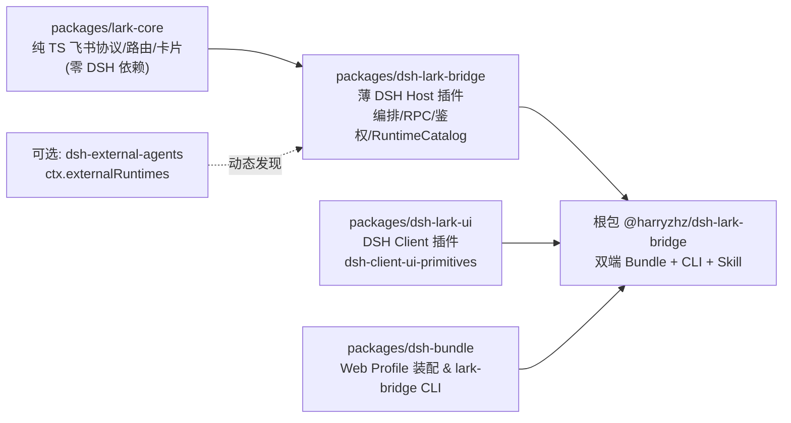

# 架构分层与工程约束

本文档说明 `dsh-lark-bridge` 的防腐层模块划分、运行产物边界以及 HTTP / RPC / Desktop 鉴权与接管约束。

## 1. 仓库分层（防腐层架构）

| 模块路径 | 职责与边界 |
| --- | --- |
| `packages/lark-core` | 纯 TS 飞书多智能体长连接、SDK 脱敏日志与错误码翻译（`lark-logger`）、开放平台与 OAuth 认证、群路由、`<system_reminder>` / `<user_message>` 合成、监听规则、代答协作、卡片与实验性 Dreaming / 主动工作协议层（**零 DSH 依赖**） |
| `packages/dsh-lark-bridge` | 薄 DSH Host 插件：模块化编排（`LarkBridgeManager` 协调 `BotConnectionPool` / `SessionCoordinator` & `SessionActor` / `InboundPipeline` / `AgentToolFacade` / `SessionTitleGuard` / `InstanceLock` / `SplitBrainDetector` / `Diagnostics`）、基于 Node/Electron 原生 `node:sqlite` WAL 的分层仓储与自动迁移引擎（`storage/*`）、Dreaming 离线记忆整理、一次性智能提醒、本地目录浏览、运行时目录聚合、工作区与过期会话归档、定时任务群通知、斜杠命令及 Web / Desktop RPC / CLI 鉴权 API |
| `packages/dsh-lark-ui` | DSH Client 插件：基于 `@deepseek-ai/dsh-client-ui-primitives` 原生组件构建的概览、智能体、群聊、自动化（定时任务 + 提醒事项）与会话管理界面及悬浮配置窗 |
| `packages/dsh-bundle` | 自托管 Web Profile 装配工具（`cordis.patch.yml`、`dsh-lark-ctl.mjs`，支持 `--external-agents` 按需叠加独立外部运行时插件）与 Agent 辅助命令行源码（`lark-bridge.mjs`） |
| 根包 `@harryzhz/dsh-lark-bridge` | `package.json` + `cordis.patch.yml` + `scripts/prepare-root.mjs`，面向 DSH Desktop / Web「添加插件」发布的零侵入独立双端 Bundle（整合 Host + Client UI + `lark-bridge` CLI + Skill，支持 GitHub 仓库直装 / Release `.tgz` / 本地目录安装） |
| `skills/lark-bridge` | 配套 `lark-bridge` Agent 技能（`SKILL.md`），自动同步至 `~/.agents/skills/lark-bridge/` |

## 2. 防腐层与能力驱动约定

- **协议层零宿主依赖**：`packages/lark-core` 不得反向依赖任何 `@deepseek-ai/*` 包。
- **动态运行时发现**：业务桥接层与前端统一通过 `RuntimeCatalog` / `/api/lark-bridge/runtimes` 动态读取 DSH 原生预设及可选的 `ctx.externalRuntimes`（由独立配套插件 `dsh-external-agents` 提供），**禁止硬编码引擎分支**。
- **记忆路径解耦（跨运行时 Memory）**：桥接层不得感知或硬编码各 Agent 运行时私有的本地记忆文件路径，而是通过统一、运行时无关的 Memory 层（SQLite `memory_entries` + FTS5 trigram 索引 + `$DSH_HOME/lark-bridge/memory/<botId>/MEMORY.md` 只读镜像）提供首轮有界渐进披露注入与 `lark-bridge memory` 按需检索/沉淀/双时态纠偏能力，供所有原生与外部运行时及 Auto-Dream 离线整理共享。

## 3. 产物目录边界

| 产物类型 | 存放路径 | 约束 |
| --- | --- | --- |
| 产品运行期全局数据与状态 | `~/.dsh/lark-bridge/`（`$DSH_HOME/lark-bridge`） | 包含 `lark-bridge.db`（SQLite WAL 主库，含 `memory_entries`、`triage_context_scopes`、`pending_turns`）、`memory/<botId>/MEMORY.md`（Memory 人类可读只读镜像）、`dreaming/<botId>/recent-transcripts.md`、`config.snapshot.json`（低频配置只读灾备快照）、`bridge.lock`（本机 PID 互斥锁）、`operator-token`（本机运维排空凭证）、`backups/`（迁移前 JSON 原样备份与热备）、`cli-endpoint.json`、`open-platform-session.json`、`user-oauth-tokens.json`（POSIX `0o700` / `0o600`） |
| 目标工作区产品产物（如消息附件） | `<workingDir>/.dsh-lark-bridge/` | 自动写入目标仓库 `.gitignore` |
| 主动代码修改隔离工作树 | `<workingDir>/.worktrees/` | 自动写入目标仓库 `.gitignore` |
| 本仓库研发临时产物 | `<本仓库>/.local/` | 仅用于开发 `dsh-lark-bridge` 自身；**严禁将产品运行产物写入目标工作区的 `.local/` 目录** |

## 4. HTTP / RPC 鉴权与 Desktop 会话接管约束

- **统一鉴权与载体无关通道**：
  - 面向 `@deepseek-ai/dsh@0.2.2-rc.5` 与 `0.2.3-alpha.2+` 的自定义 HTTP 路由（`/api/lark-bridge/*`）在注册时显式声明 `auth: 'anonymous'`（保留外层 Host/Origin 防重绑定校验，避免 `0.2.3-alpha.2+` 默认 `required` 策略拦截 CLI Bearer / Operator Token），并在插件内显式执行受限 CLI / Operator Bearer Token 或 `ctx.connection.admit(req)` 的 fail-closed 鉴权；跨站顶层导航（`/open`、`/console-login` 的 `GET/HEAD`）同步挂载于 `webserver/request`，认证入口 URL 兼容 `connection.authenticatedUrl` 与 `webserver/entry-url` 事件。
  - Web 与 Electron Desktop 客户端统一走 `ctx.connection.fetch.register('/api/lark-bridge-rpc')` + `ctx.connection.rpc.call('/api', 'lark-bridge-rpc', ...)` 载体无关通道（兼容 Desktop `file://` 渲染进程与 `__DSH_TRANSPORT__`）。
  - 宿主机本地目录浏览接口（`/api/lark-bridge/fs/dirs`）、只读链接密钥重置接口与桌面端会话打开通道严格限定 Owner 会话访问；优雅排空与恢复入站接口（`/api/lark-bridge/lifecycle/drain|resume-intake`）限定 Owner 会话或独立 `0o600` `operator-token`，普通 Agent CLI Token 禁止访问。
- **Electron Desktop 适配**：
  - `cli-endpoint.json` 由 `bridge-manager.ts` 在 `webServer` 就绪后以 `webServer.getOrigin()` 动态回填，以适配 OS 随机端口。
  - `cli-support.ts` 生成的 `lark-bridge` 包装脚本自动注入 `ELECTRON_RUN_AS_NODE=1` 并支持 Windows `.cmd`。
- **会话接管与只读查看（`/api/lark-bridge/open`）**：
  - **绝不向飞书消息泄露主 `launchToken`**，统一使用进程级随机密钥签发的 HMAC 票据。
  - **Loopback 监听**：优先经由桌面端 `dsh-app://app` 渲染进程长轮询通道（`/desktop/open-wait` + `/desktop/open-ack`）直接切至桌面 APP 会话页并通过官方 `dsh://open` 置顶窗口；无桌面窗口或显式 `mode=web` 时平滑回退到同源 HTML 跳转 `ctx.connection.authenticatedUrl` 完成浏览器首跳鉴权。
  - **非 Loopback（局域网 / 服务器 / 反代）**：绝不签发 `launchToken`；已认证 Owner 直达完整会话，未登录群成员仅在开启「允许群成员只读查看」并持有效票据时经 DSH 原生 `RemoteAccessService`（`lark-viewer` 策略）进入单会话只读视图（详见 [SECURITY.md](../../SECURITY.md)）。

## 5. 静态资源生成

- 飞书表情反馈资源由 `packages/dsh-lark-ui/scripts/generate-emoji-assets.mjs` 从飞书开放平台官方目录生成，不手工拼装表情资源表。
