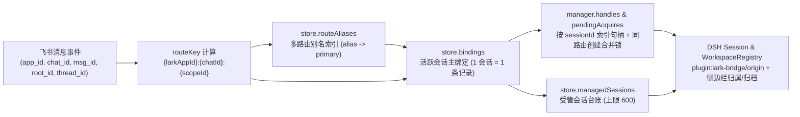
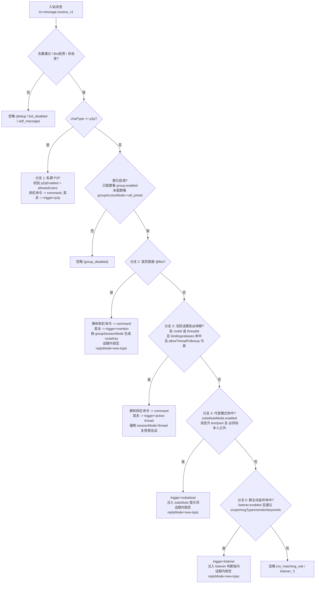
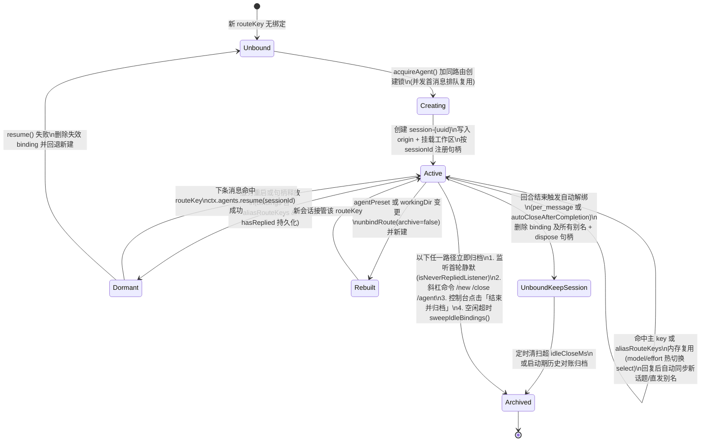
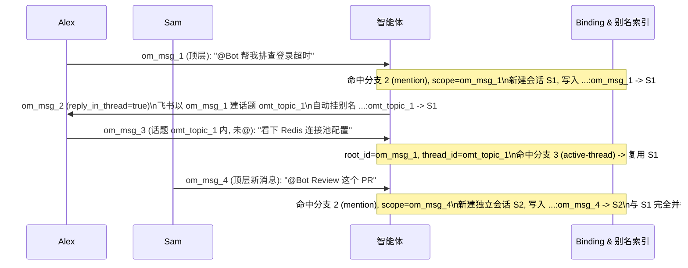
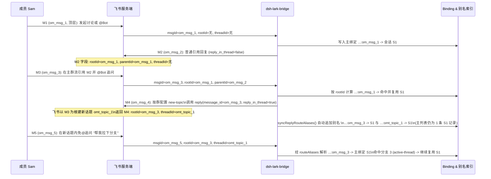

# 会话管理机制与场景示例

本文档系统说明 `dsh-lark-bridge` 在飞书（Lark）消息拓扑与 DeepSeek Harness（DSH）会话之间的映射、路由、复用、热切换与自动归档机制，并给出典型配置模式下的端到端示例。

> 核心源码参考：
> - 路由与上下文协议：[packages/lark-core/src/router.ts](../../packages/lark-core/src/router.ts)、[packages/lark-core/src/types.ts](../../packages/lark-core/src/types.ts)、[packages/lark-core/src/lark-transport.ts](../../packages/lark-core/src/lark-transport.ts)
> - 会话编排与生命周期：[packages/dsh-lark-bridge/src/session-coordinator.ts](../../packages/dsh-lark-bridge/src/session-coordinator.ts)、[packages/dsh-lark-bridge/src/inbound-pipeline.ts](../../packages/dsh-lark-bridge/src/inbound-pipeline.ts)、[packages/dsh-lark-bridge/src/store.ts](../../packages/dsh-lark-bridge/src/store.ts)、[packages/dsh-lark-bridge/src/workspace-grouping.ts](../../packages/dsh-lark-bridge/src/workspace-grouping.ts)
> - 特殊会话与交互入口：[packages/dsh-lark-bridge/src/slash-commands.ts](../../packages/dsh-lark-bridge/src/slash-commands.ts)、[packages/dsh-lark-bridge/src/schedule-notifier.ts](../../packages/dsh-lark-bridge/src/schedule-notifier.ts)、[packages/dsh-lark-bridge/src/reminder-service.ts](../../packages/dsh-lark-bridge/src/reminder-service.ts)、[packages/dsh-lark-bridge/src/dreaming-service.ts](../../packages/dsh-lark-bridge/src/dreaming-service.ts)

---

## 1. 核心数据模型与状态分层

系统采用 **「单一会话实体 + 多路由别名索引」** 的解耦模型，通过四套互补状态维护「飞书对话实体 ↔ DSH 会话」的完整生命周期：



| 状态层 | 存储位置 | 键值映射 | 核心职责 |
|---|---|---|---|
| **活跃路由绑定 `bindings` + 别名索引 `binding_aliases`** | SQLite WAL 主库 `$DSH_HOME/lark-bridge/lark-bridge.db`（外键级联） | 主键 `routeKey` → `LarkSessionBinding`（含关联 `aliasRouteKeys`）；`aliasRouteKey` → `primaryRouteKey` | 决定**会话复用**与**活跃话题免 `@` 续聊**的唯一索引；支持多飞书锚点（原引用根、升级后话题根、`omt_*` 话题 ID、`chat` 模式直发消息 ID）透明指向同一份主绑定，确保单点真相且 UI 会话列表不重复 |
| **受管会话台账 `managed_sessions`** | 同上（按 `lastActivityMs` 淘汰，上限 600 条） | `sessionId` → `LarkManagedSession` | 覆盖所有桥接创建的会话（含 `per_message`、已解绑会话、`schedule`、`reminder`、`dreaming`），支撑**超时兜底归档**与 **Dreaming 增量整理** |
| **进程内句柄与并发控制** | `SessionCoordinator` 内存 `SessionActor`（5 态：`creating → idle → running → closing → archived`）与 `pendingAcquires` | `sessionId` → `SessionActor`（持有 `AgentHandle` 与 FIFO 串行队列）；`primaryRouteKey` → `Promise` | 按 `sessionId` 独占管理运行时句柄与回合串行化避免覆写泄漏；同路由并发首消息串行复用单次创建；`running` 期间阻塞空闲归档与抢占释放 |
| **DSH 原生归属与溯源** | DSH Session 事件流 + `workspaceRegistry` | `sessionId` → `plugin:lark-bridge/origin` & `workspaceId` | 挂载到目标工作区、经 `SessionTitleGuard` 维护会话标题净化、供定时任务/提醒反推来源群与话题、供启动期历史会话识别与归档 |

---

## 2. 飞书消息拓扑与 `routeKey` 计算规则

理解群聊会话复用前，需先明确飞书 IM 在三种回复形态下发给机器人的字段差异：

| 飞书消息形态 | 触发方式 | `root_id` | `parent_id` | `thread_id` |
|---|---|---|---|---|
| **顶层消息** | 群主消息流直接发送 | 无 | 无 | 无 |
| **普通引用回复** | 用户点击「回复」或机器人调用 `im.message.reply(reply_in_thread: false)` | 指向引用链最初的顶层消息 ID | 指向直接被引用的消息 ID | 无 |
| **飞书原生话题** | 在话题内回复，或机器人调用 `im.message.reply(reply_in_thread: true)` | **指向该话题的根消息 ID** | 指向话题根消息或被引用消息 ID | `omt_...`（话题容器 ID） |

### `routeKey` 统一格式与别名同步

```text
{larkAppId}:{chatId}:{scopeId}
```

不同触发路径下 `scopeId` 的计算规则如下：

| 场景 / 会话模式 | 入站 `scopeId` 计算方式 | 回复后自动挂载的路由别名（`syncReplyRouteAliases`） |
|---|---|---|
| 私聊 · `p2pSessionMode = chat`（每人一个会话） | `p2p` | 无（固定单键） |
| 私聊 · `p2pSessionMode = per_message`（每条消息新建） | `msg:{messageId}` | 无（单轮即解绑） |
| 群聊 · `sessionMode = thread`（按话题复用） | 优先 `msg.rootId ?? msg.threadId ?? msg.messageId`；若 `rootId` 未命中活跃绑定且 `threadId` 存在，自动回退检查 `msg.threadId` | 1. 飞书返回的 `sent.rootId` 与 `sent.threadId`；<br>2. 非话题消息按 `new-topic` 升级为话题时的 `msg.messageId`；<br>3. `replyMode = chat` 群内直发时的 `sent.messageId` |
| 群聊 · `sessionMode = chat`（全群共享） | `chat` | 无（全群固定单键） |
| 群聊 · `sessionMode = per_message`（每次新建） | `msg:{messageId}` | 无（单轮即解绑） |
| 群聊 · 斜杠命令（`@Bot /status` 等） | `groupSessionMode === 'chat'` 时用 `chat`，否则按 `thread` 规则解析 | 同绑定透明解析（在原引用或新话题内发 `/new` 均作用于同一会话） |
| 定时任务 / 提醒事项推送后回写 | 发回原话题时用 `replyToMessageId`；群内直发时用 `sent.messageId` | 若飞书返回 `sent.threadId`，同步挂为别名；替换同路由旧会话时安全释放空闲旧句柄 |

> **CLI 与提醒锚点跟随**：当会话因话题升级新增了新的 `om_*` 路由别名时，`resolveAgentContext(sessionId)` 与提醒溯源会优先取最新的 `om_*` 锚点，确保 `lark-bridge history` / `lark-bridge send` / 提醒推送直接落入当前活跃话题。

---

## 3. 分层配置与生效优先级

会话行为由 **智能体默认配置（`LarkBotConfig`）**、**群聊独立覆盖（`LarkGroupConfig`）** 和 **主动监听规则（`group.listener`）** 三层共同决定：

| 配置项 | 智能体默认 | 群聊覆盖 | 主动监听（`listener`）命中时 | 活跃话题续聊（`active-thread`）命中时 |
|---|---|---|---|---|
| **会话策略 (`sessionMode`)** | `groupSessionMode`（默认 `thread`） | `inherit` / `thread` / `per_message` / `chat` | **强制用 `listener.sessionMode`**（默认 `per_message`） | **强制为 `thread`** |
| **回复方式 (`replyMode`)** | `groupReplyMode`（默认 `new-topic`，UI 称「话题内回复」） | `inherit` / `new-topic` / `reply` / `chat` | **未在话题中时**用 `listener.replyMode`；**已在话题中时锁定 `new-topic`** | 若原为 `listener` 且无 `threadId` 则用 `listener.replyMode`，其余锁定 `new-topic` |
| **触发方式 (`mentionTriggerMode`)** | `mention_and_active_thread` / `mention_only` | `inherit` / 覆盖 | 不受此项控制，由监听过滤规则决定 | 决定是否允许 `mention` / `listener` / `schedule` / `reminder` 话题免 `@` 续聊 |
| **空闲归档 (`idleCloseMinutes`)** | 默认 `720`（12 小时，0 为关闭） | 可选覆盖 | 继承群 / 智能体生效值 | 继承群 / 智能体生效值 |
| **允许空输出静默 (`allowSilentEmptyReply`)** | 固定 `false` | 固定 `false` | 由 `listener.allowSilentEmptyReply` 决定（默认 `true`） | 原为 `listener` 话题时继承 `listener.allowSilentEmptyReply`，否则 `false` |
| **完成后自动关闭 (`autoCloseAfterCompletion`)** | 仅 `per_message` 时为 `true` | 仅 `per_message` 时为 `true` | `listener.autoCloseAfterCompletion \|\| listener.sessionMode === 'per_message'` | 固定 `false` |
| **运行时与工作目录** | `agentPreset` / `model` / `reasoningEffort` / `defaultWorkingDir` | `runtimeMode: override` 与 `workingDir` 可独立覆盖 | 继承群 / 智能体生效值 | 继承群 / 智能体生效值 |

> **关键设计不变量**：
> 1. **已在话题内则留话题（`resolveReplyModeInContext`）**：当入站消息已处于飞书原生话题中（`Boolean(msg.threadId)`）时，无论命中 `@Bot`、斜杠命令、活跃话题、代答还是主动监听，均固定以 `replyMode = 'new-topic'`（`reply_in_thread: true`）在原话题内回复，不会把回复甩到群主消息流外面；仅当消息尚未进入话题（`!msg.threadId`）时，才按配置的 `replyMode` 决定新建话题、普通引用回复还是群内直发。
> 2. **代答模式自动升级**：当命中 `substituteMode`（`@代答目标`）时，若 `activeThreadFollowup === true` 且群会话模式为 `per_message`，路由器会自动升级为 `thread` 以支持话题内持续跟进。

---

## 4. 五级入站路由决策链

每条经 WebSocket 长连接到达的消息先通过 `MessageDeduplicator`（按 `{larkAppId}:{messageId}` 去重），过滤禁用智能体与机器人自发消息后，严格按 **1 → 5 短路优先级** 路由（[router.ts:417-687](../../packages/lark-core/src/router.ts#L417-L687)）：



### 分支 3（`active-thread`）续聊准入矩阵

当群内消息未直接 `@Bot`，但带有 `rootId` 或 `threadId` 且通过主 `routeKey` 或 `aliasRouteKeys` 命中活跃绑定时，放行条件取决于该绑定最初的 `trigger`：

| 原绑定 `trigger` | `allowThreadFollowup` 放行条件 | 续聊是否允许空输出静默 |
|---|---|---|
| `mention` / `schedule` / `reminder` | `mentionTriggerMode === 'mention_and_active_thread'` | 否（`false`） |
| `substitute` | `bot.substituteMode.activeThreadFollowup === true` | 否（`false`） |
| `listener` | **`binding.hasReplied !== false`**（持久化跨重启保留）且 `mentionTriggerMode === 'mention_and_active_thread'` | 是（继承 `listener.allowSilentEmptyReply`） |

---

## 5. 会话生命周期状态机（创建、复用、热切换与归档）



### 5.1 复用、热切换、并发保护与强制重建

当 `decision.sessionMode !== 'per_message'` 时（见 [session-coordinator.ts](../../packages/dsh-lark-bridge/src/session-coordinator.ts)）：

| 场景 | 行为 | 是否保留原对话历史 |
|---|---|---|
| **仅变更 `model` 或 `reasoningEffort`** | 复用原会话，调用 `agent.model.select(...)` 热切换并更新 binding（保留全部别名） | 保留 |
| **变更 `agentPreset` 或 `workingDir`** | 调用 `unbindRoute(existing.routeKey, { archive: false })`，以新运行时/目录新建会话 | 新建（旧会话待超时归档） |
| **同话题多消息并发到达** | `pendingAcquires` 按主 `routeKey` 串行合并首轮创建：第一条创建（`isNew: true`），后续等待并直接复用同一会话（`isNew: false`） | 共享同一会话 |
| **服务重启后内存无句柄** | `ctx.agents.resume(sessionId)` 恢复持久化会话；恢复失败才清理 binding 并新建 | 保留 |
| **首轮 vs 续轮提示词** | 首轮（`isNew: true`）注入 `<role>`、`<proactive>` 与完整 `lark-bridge` 工具指引；续轮只注入本轮 `<lark_context>` 与 `turnReminders` | 续轮共享会话上下文 |

### 5.2 四条关闭与归档路径

1. **回合结束即时处理**：无并发轮次（`inFlightTurns <= 1`）时，`per_message` 或 `autoCloseAfterCompletion = true` 删除 binding（含别名）并按 `sessionId` 释放句柄；`isNeverRepliedListener`（监听首次静默）还会**立刻归档**该会话。
2. **周期空闲清扫（`sweepIdleBindings`，默认每 5 分钟）**：扫描超期 `bindings`（按主绑定原子清理全部别名并归档），再扫描已解绑但未归档的超期 `managedSessions` 做兜底归档。
3. **启动期历史对账（`reconcileHistoricalSessions`）**：扫描工作区遗留未归档桥接会话，超期自动归档并顺带修复被标记污染的旧标题。
4. **显式触发与后台专有会话**：`/new`、`/close`、`/agent` 与控制台「结束并归档」立即解绑全部别名并归档；Dreaming 会话执行完立即归档；Schedule / Reminder 推送后通过 `replaceRouteBinding()` 反向注册绑定并安全释放被替换的空闲旧句柄，空输出的 `new` 定时任务直接归档。

---

## 6. 各类场景与配置模式下的端到端示例

> 以下所有示例均使用脱敏占位符（应用 `cli_demo`、群聊 `oc_team`、消息 `om_msg_*`、话题 `omt_topic_*`、成员 `Alex` / `Sam`、路径 `/Users/demo/workspace`）。

### 场景 1：私聊（P2P）——「每人一个会话」vs「每条消息新建」

| 配置模式 | 连续两条私聊消息 | 生成的 `routeKey` | 会话结果 |
|---|---|---|---|
| `p2pSessionMode: chat`（默认） | 消息 1（`om_msg_1`）→ 消息 2（`om_msg_2`） | 两条均为 `cli_demo:oc_p2p_1:p2p` | 共享同一会话 `S1`，直到超过 `idleCloseMinutes` 或发送 `/new` |
| `p2pSessionMode: per_message` | 消息 1（`om_msg_1`）→ 消息 2（`om_msg_2`） | `...:msg:om_msg_1`、`...:msg:om_msg_2` | 分别新建 `S1`、`S2`，每轮结束即解绑，互不携带历史上下文 |

---

### 场景 2：群聊标准研发协作（推荐默认模式）

**配置组合**：
- `replyMode: new-topic`（话题内回复：无话题时新建话题，已在话题中时继续留在话题内）
- `sessionMode: thread`（按话题复用）
- `mentionTriggerMode: mention_and_active_thread`（`@` 或活跃话题）
- `idleCloseMinutes: 360`



---

### 场景 3：群聊严格显式触发（`mention_only`）

**配置组合**：`replyMode: new-topic`、`sessionMode: thread`、`mentionTriggerMode: mention_only`（仅 `@` 时）

| 步骤 | 消息内容与位置 | 飞书字段 | 路由命中分支 | 会话行为 |
|---|---|---|---|---|
| 1 | Alex 顶层发 `@Bot 帮查下发布流水线` | `msgId=om_msg_1` | 分支 2（`mention`） | 新建 `S1`，绑定 `...:om_msg_1 → S1` 并拉起话题 |
| 2 | Sam 在话题内回复 `Alex 你看下是不是配置没同步`（未 `@Bot`） | `rootId=om_msg_1`, `threadId=omt_topic_1` | 分支 3 被 `mention_only` 拒绝 → `ignore` | **零打扰**，不唤醒 Agent |
| 3 | Alex 在同一话题内回复 `@Bot 对比下生产和测试配置` | `rootId=om_msg_1`, `threadId=omt_topic_1` | 分支 2（`mention`），`scope=om_msg_1` | **复用 `S1`**，且留在原话题内回复 |

---

### 场景 4：群聊无状态问答（`per_message`）、全群共享（`chat`）与直发续聊

| 模式 | 配置要点 | `routeKey` 与别名变化 | 典型行为 |
|---|---|---|---|
| **每次新建** | `sessionMode: per_message` + `replyMode: reply` | `...:msg:om_msg_1`、`...:msg:om_msg_2`（无持久化 binding） | 每次 `@Bot` 开启干净会话，回复完立刻解绑，不触发免 `@` 续聊 |
| **全群共享** | `sessionMode: chat` + `replyMode: chat` | 始终为 `cli_demo:oc_team:chat` | 群内所有 `@Bot` 消息共享同一个长期会话；若在某个已有话题内 `@Bot`，回复仍自动留在原话题内 |
| **群内直发 + 按话题复用** | `sessionMode: thread` + `replyMode: chat` | 顶层 `@Bot` 绑定 `...:om_msg_1 → S1`；群内直发 `om_msg_2` 后自动追加别名 `...:om_msg_2 → S1` | 成员直接点击引用/回复 Bot 直发的 `om_msg_2`（`root_id = om_msg_2`），透明命中 `S1` 无缝续聊 |

---

### 场景 5：代答模式（`substituteMode`）的两种跟进策略

**前置条件**：智能体启用 `substituteMode`，代答目标为 `Alex (ou_alex)`。

1. **`activeThreadFollowup: true`（开启话题持续跟进）**：
   - Sam 在群内发 `om_msg_1`：`@Alex 这个接口限流阈值是多少？`（未 `@Bot`）
   - 命中分支 4（`substitute`）；即便群配置为 `per_message`，也会自动升级为 `thread`，写入 `...:om_msg_1 → S1`。
   - 后续 Sam 在话题内免 `@` 追问 → 命中分支 3（`active-thread`）复用 `S1`（即便群为 `mention_only` 也放行）。
   - **防自触发**：Alex 本人发消息提及自己时不会触发代答。
2. **`activeThreadFollowup: false`（仅单轮代答）**：
   - 命中分支 4 后 `autoCloseAfterCompletion = true`，回复完毕立刻解绑并释放句柄，后续不自动续跟。

---

### 场景 6：主动监听（`listener`）典型模式组合

#### 6a. 告警排查 / 项目讨论（话题续聊型）
- **配置**：`scope: top_level`、`replyMode: new-topic`、`sessionMode: thread`、`allowSilentEmptyReply: true`、`autoCloseAfterCompletion: false`
- **静默路径**：噪音消息建立临时绑定（`hasReplied: false`）→ Agent 输出空文本 → 判定 `isNeverRepliedListener` → **立即解绑、释放句柄并归档**，飞书群与 DSH 侧边栏均零残留。
- **回复路径**：命中真实告警/问题输出回复并置 `hasReplied: true`（跨重启持久化）→ 后续话题内免 `@` 追问进入分支 3 复用原会话，并保留空输出静默能力（同事间「收到」「我来改」继续静默）。

#### 6b. 未回复监听话题的防劫持保护
- 在监听首轮推理尚未回复（`hasReplied: false`）期间，若有其他群友在该消息下回复，分支 3 检查 `hasRouteReplied` 为 `false` 直接拒收，不会被提前劫持进 `active-thread`（重启后 `hasReplied: false` 同样保留）。

#### 6c. 变更观察 / 轻量日常（单次即关型）
- **配置**：`scope: top_level`、`replyMode: chat / reply`、`sessionMode: per_message`、`autoCloseAfterCompletion: true`
- 每条顶层消息独立评估，发现风险则提示一次并释放，不保留长期绑定。

---

### 场景 7：定时任务（`schedule`）与一次性提醒（`reminder`）推送转追问

| 投递模式 (`deliveryMode`) | 飞书发送方式 | 反向写入 `bindings` | 后续群内追问效果 |
|---|---|---|---|
| `chat`（群内直发） | 群主消息流发结果卡片，返回 `sent.messageId = om_card_1` | `cli_demo:oc_team:om_card_1 → S_job`（若有 `sent.threadId` 同步挂别名） | 成员直接回复该卡片即可复用 `S_job` 上下文追问 |
| `thread`（发回原话题） | 对来源 `replyToMessageId = om_orig_1` 调用 `reply_in_thread: true` | `replaceRouteBinding` 更新 `cli_demo:oc_team:om_orig_1 → S_job`（若替换了旧绑定且无在途回合，安全释放旧句柄） | 在原话题继续回复即衔接最新巡检/提醒结论 |

---

### 场景 8：混合 `replyMode` 下的引用链升级为话题（自动别名同步）

当同一条对话链**前半段为普通引用回复（无 `thread_id`）**、**后半段按 `replyMode: new-topic` 回复**（例如群内同时存在 `listener.replyMode: reply` 与 `group.replyMode: new-topic`，或中途将群从 `reply` 切换为 `new-topic`）时，`syncReplyRouteAliases()` 会自动桥接飞书的新旧锚点，保证会话不中断：



**关联保障**：
- 在该新话题中执行 `lark-bridge history` / `lark-bridge send` 或创建提醒时，`extractBindingReplyAnchor()` 会自动取最新 `om_*` 锚点（`om_msg_3`），精准命中新话题；
- 在该新话题中发 `@Bot /new` 或在控制台点击「结束并归档」时，`deleteBinding()` 会按主绑定一次性清理 `om_msg_1`、`om_msg_3`、`omt_topic_1` 全部键并释放 `S1` 句柄。

---

### 场景 9：斜杠命令与控制台操作对会话的影响速查

| 操作 | 路由 / 句柄变化 | 归档动作 | 生效时机 |
|---|---|---|---|
| `/status` | 无变更 | 无 | 立即返回当前会话 ID、工作区、运行时、模型、目录与 DSH 接管链接 |
| `/new` 或 `/close` | 删除主绑定与全部别名，按 `sessionId` 释放句柄 | 立即归档原会话 | 下一条消息创建新会话 |
| `/cancel` | 保持绑定不变 | 无 | 向运行中 Agent 发送 `cancel({ kind: 'user' })` 中断当前回合 |
| `/model <id>` | 保持绑定不变 | 无 | 运行中会话直接 `agent.model.select()` 立即生效，并同步更新群独立模型或 Bot 默认模型 |
| `/agent <id>` | 更新群独立运行时或 Bot 默认运行时，删除主绑定与全部别名 | 立即归档原会话 | 下一条消息以新运行时创建会话 |
| 控制台「会话 → 结束并归档」 | 删除主绑定与全部别名，按 `sessionId` 释放句柄 | 立即归档 | 立即生效 |
| 控制台修改群 `model` / `reasoningEffort` | 保持原绑定（含别名）与会话 | 无 | 下一条消息进入 `resumeAgent` 时热切换 |
| 控制台修改群 `agentPreset` / `workingDir` | 下一条消息到达时解绑旧路由（含别名）并新建会话 | 旧会话待空闲超时归档 | 下一条消息生效 |

---

## 7. 智能分流与忙碌队列合批

当群聊消息高频且混杂闲聊、确认语与正式研发任务时，可在智能体「Agent 运行时 → 智能分流」开启无状态前置分流，也可在单个群聊「Agent 运行时 → 智能分流」中独立覆盖（支持 `跟随智能体` / `独立配置` / `关闭`，涵盖分流模型、生效范围、分流超时、忙碌队列合批与群级补充判断规则），以消除高思考主运行时的冷启动与排队阻塞：

- **无状态轻量分流闸门（`LlmTriageService`）**：直接调用 DSH 原生或自定义配置的 `ctx.llm.stream()`（自动选择模型最低推理强度、思考模型自动省略 `temperature` 并放宽 `maxTokens`、不创建 DSH Session、不挂载工作区、并发不阻塞主运行时），通过结构化 `route_message` 工具调用（兼容 JSON 回退）输出三态裁决：
  - `silent`：闲聊或无需回应的纯确认语，零飞书写入（不贴 `OnIt` 表情）、零会话创建；
  - `quick_reply`：**仅在当前路由尚无活跃主会话时允许**，直接以简洁纯文本回复并在内存记录临时轻回复话题（TTL 30 分钟）；若群友随后在该话题下免 `@` 追问并升级为正式任务，自动将前序问答拼装为 `<router_handoff_context>` 注入主运行时首轮并承接话题别名；
  - `handoff`：安静贴上 `OnIt` 表情并直接交由当前 Agent 主运行时接管处理，后续由主运行时直接回复飞书，不再经分流层转发。
- **已接管话题防误杀不变量**：当 `routeKey` 已存在活跃主会话绑定时，裁决空间强制收敛为 `silent | handoff`（禁止 `quick_reply`），并向分流模型喂入主运行时当前运行状态与上一轮回复末尾摘要，避免把对反问的“好的 / 选 B”误判为普通确认吞掉。
- **两种生效范围与 Fail-Open 安全网**：
  - `passive_only`（推荐默认）：仅拦截 `listener` 与 `active-thread`，显式 `@Bot` 直达主运行时；
  - `all_group`：覆盖全部群聊消息（含显式 `@Bot`），私聊 `p2p` 始终直达主运行时；
  - 含图片/文件附件、非监听长文本或代码块、原生模型未配置、分流超时（默认 4s）或异常时均自动安静 Fail-Open 直通主运行时。
- **忙碌队列合批（`coalesceQueuedMessages`）**：当目标 `SessionActor` 正在 `running` 时，期间通过分流进入等待区的多条有效消息自动合并为一个增量批次，在当前回合结束后作为单轮 Turn 提交给主运行时，统一清理全部批次表情与待完成记录；空闲会话首条消息零等待直发。

---

## 8. 关键并发与一致性不变量

1. **单会话多锚点（`aliasRouteKeys`）**：所有写操作（`touchBinding`、`markBindingReplied`、`deleteBinding`）统一经 `resolvePrimaryRouteKey()` 落到单一主实体，确保空闲超时计时、`hasReplied` 标记与解绑归档不会发生副本分裂。
2. **句柄归属 `sessionId`**：`handles` 以 `sessionId` 为键，解绑或跨会话覆写绑定（`replaceRouteBinding`）时均精准释放目标句柄，杜绝孤立句柄泄漏。
3. **同路由并发创建合并**：`pendingAcquires` 在 `acquireAgent()` 层对同一主 `routeKey` 的异步创建加锁，避免用户在全新话题内连发多条消息时并发拉起多个重复会话。
4. **回复形态与会话复用正交**：`replyMode` 仅在消息尚不在飞书话题中（`!msg.threadId`）时决定投递容器；一旦进入话题，回复始终留在话题内，并通过回执别名同步保证 `sessionMode: thread` 在任何合法配置组合下都不丢失上下文。
